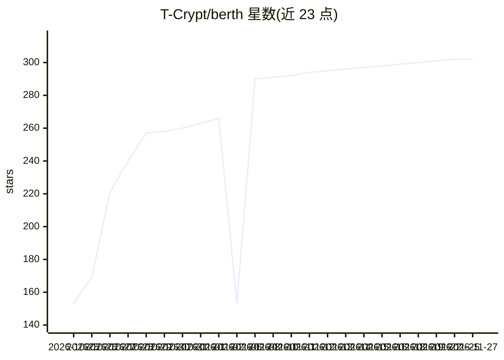

# T-Crypt/berth

⭐ 302 · Go · Apache-2.0 · 推送 2026-11-20 · [GitHub](https://github.com/T-Crypt/berth) · [官网](https://t-crypt.github.io/berth/) · 个人维护

**单机 GPU 租约管理器：让多个 GPU 程序排队轮流用显存**

用 Go 编写的本地 GPU 资源管理器（守护进程 berthd），通过租约机制协调聊天模型、图像管线、语音引擎、游戏等进程对 GPU 显存的使用：按优先级排队、等持有者完成当前任务后卸载、等驱动确认显存释放再授予下一个，避免多进程同时加载导致 OOM。提供 OpenAI 兼容网关按需启动引擎、RAM 驻留与 cuda-checkpoint 快速切换、按卡预订时段、模型下载校验、遥测与 web UI。当前为 alpha（v0.6.1），Linux 为主、Windows 实验性支持。

## 筛选速览

| 维度 | 判定 | 备注 |
|---|---|---|
| AI 角色 | `ai-ecosystem` | LLM/agent 周边工具 |
| 许可风险 | `permissive` | Apache-2.0 |
| 部署形态 | `desktop` | 安装包/桌面程序 |
| 模型依赖 | local-ok | 支持本地模型 |
| 硬件要求 | — | 无带数字的原话,不猜 |
| 安装摩擦 | `low` | 无编译、无系统依赖或容器化 |
| 成熟度 | `idea` | |

## 能力要点

- 租约+四级优先级（hold/foreground/interactive/batch）的 GPU 排队与交接机制
- OpenAI 兼容网关：一个端口按需启动/卸载引擎并流式返回
- RAM 驻留与 cuda-checkpoint 加速引擎切换，支持 Docker/Podman 容器引擎
- 自动发现 llama.cpp/Ollama/vLLM/ComfyUI 等引擎，报告无租约占用显存的进程

## 适用场景

- 单机上让 LLM 引擎、ComfyUI、游戏共用一张卡而互不挤爆显存
- 给 AI agent 提供统一网关按需启动对应模型引擎
- 为训练/微调任务整卡独占并阻止自动抢占
- 查看显存占用、队列等待原因与每张卡的遥测数据

## 场景标签

`模型网关` · 领域:Agent 开发

## 证据(README 行号)

> L13: Berth makes the programs on your PC take turns with the GPU's memory, so they stop crashing each
> L126: - **`berth gateway`**: one OpenAI-compatible port. Name a model and Berth starts its engine,
> L160: - **Finds your engines.** Berth reads llama.cpp, llama-swap, Ollama, vLLM, SGLang, ComfyUI,

## 星数曲线

2026-10-25 153 → 2026-11-27 302（+149）

---
*卡片 v1 · prompt 1.4 · 生成 2026-11-25 · 置信度 mid · 依据 README sha `58d2807252a6` · [字段定义](../../DATASET.md)*
