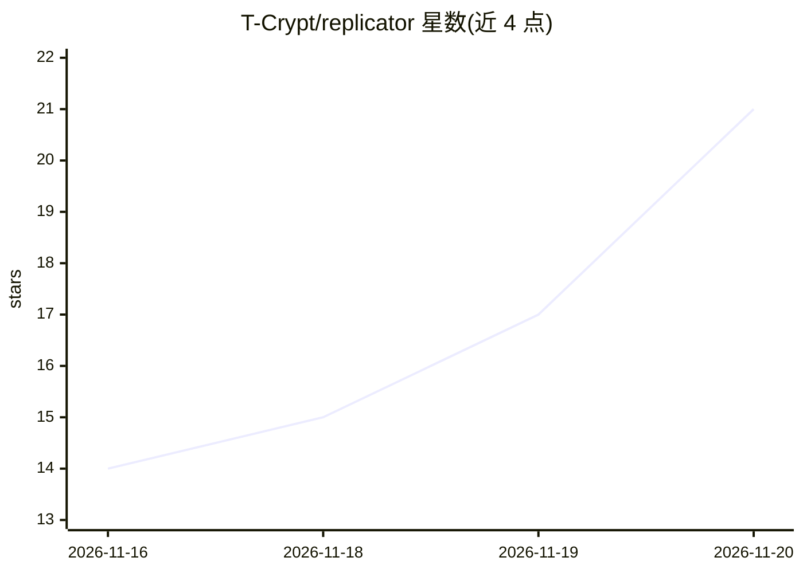

# T-Crypt/replicator

⭐ 21 · Python · MIT · 推送 2026-11-15 · [GitHub](https://github.com/T-Crypt/replicator) · 个人维护

**工程师用的一句话生成可验证三维实体建模工作台**

面向工程师与设计者的实体建模工作台：用户以一句话描述物体，语言模型经蓝图与构建程序两阶段规划，由 manifold3d 内核逐步求值为水密实体，运行 13 项测量检查并可将失败回传模型修复；支持句子编辑生成 JSON Patch、A3 图纸、STEP/DXF/GLB/STL/URDF/MJCF 导出，以及 Reverse 模式拆解已有模型并输出证据台账。模型接入为任意 OpenAI 兼容端点（默认 llama.cpp，可配 Ollama/LM Studio），几何与导出在本地 CPU 运行。需 Python 3.11+、Qt 6/PySide6；实测仅 Linux，macOS/Windows 未验证。MIT 许可。

## 筛选速览

| 维度 | 判定 | 备注 |
|---|---|---|
| AI 角色 | `ai-native` | 本体是模型或模型工具 |
| 许可风险 | `permissive` | MIT |
| 部署形态 | `library` | 以包/库形式分发 |
| 模型依赖 | — | README 未给出锁定关系 |
| 硬件要求 | — | 无带数字的原话,不猜 |
| 安装摩擦 | `medium` | 含编译或系统依赖之一 |
| 成熟度 | `idea` | |

## 能力要点

- 蓝图→BuildProgram→manifold3d 内核的两阶段生成与最多两轮修复
- 13 项测量检查（浮动件、薄壁、错位、屋顶覆盖等）逐次构建后运行
- 导出 STEP/DXF/STL/3MF/GLB/OBJ/URDF/MJCF，URDF/MJCF 含实测质量与惯量
- 任意 OpenAI 兼容端点接入，默认指向本地 llama.cpp server

## 适用场景

- 用一句话生成带尺寸、材料与质量的机器或建筑模型并导出到 CAD
- 导入现有模型在 Reverse 模式下拆解并生成证据台账
- 为 MuJoCo/ROS 仿真导出含质量与惯量的 URDF/MJCF
- 以种子基准与语料导出评测模型的工程建模能力

## 场景标签

`模型评测` · 领域:评测与运维

## 证据(README 行号)

> L17: language model plans it from engineering knowledge and writes a build program. A solid-modelling
> L80:  How Replicator works. Five stages: a sentence that specifies the object, a blueprint written by the model you choo
> L167: Specifying, editing by sentence, naming parts and explaining need an OpenAI-compatible chat

## 星数曲线

2026-11-16 14 → 2026-11-20 21（+7）

---
*卡片 v1 · prompt 1.4 · 生成 2026-11-18 · 置信度 high · 依据 README sha `7e607c0b591d` · [字段定义](../../DATASET.md)*
