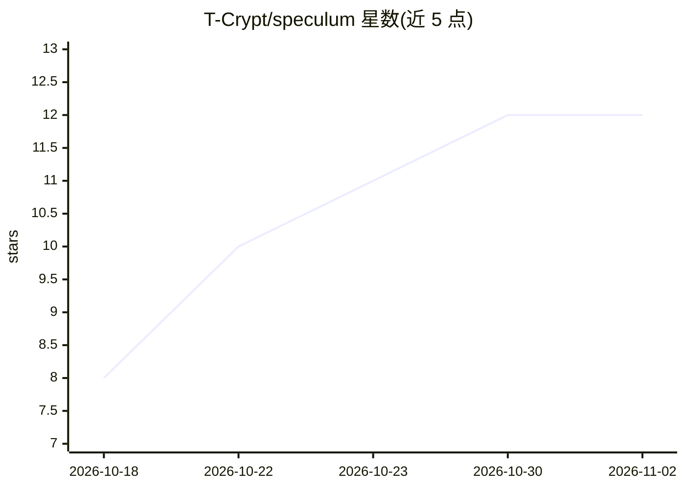

# T-Crypt/speculum

⭐ 12 · Python · MIT · 推送 2026-10-17 · [GitHub](https://github.com/T-Crypt/speculum) · 个人维护

**单机本地 LLM 运行时监控面板：采集引擎与 GPU 指标并网页展示**

面向在本地 GPU 服务器上跑模型的运维者：Python 采集器轮询 llama-swap、NInfer、Strata、Ollama、vLLM、LM Studio 等引擎及 nvidia-smi、主机指标，在单页上以 12 个面板展示吞吐、延迟、上下文占用、KV 池、事件流等，并提供 1 Hz SSE 数据流。采集器仅用标准库、前端纯 HTML/CSS/ES modules，无需安装构建；长视图写入 SQLite。默认仅绑定 127.0.0.1:8792，远程查看需借助 tailscale 等方式；可脱离 GPU 机在容器中运行。

## 筛选速览

| 维度 | 判定 | 备注 |
|---|---|---|
| AI 角色 | `ai-ecosystem` | LLM/agent 周边工具 |
| 许可风险 | `permissive` | MIT |
| 部署形态 | `desktop` | 安装包/桌面程序 |
| 模型依赖 | local-ok | 支持本地模型 |
| 硬件要求 | — | 无带数字的原话,不猜 |
| 安装摩擦 | `medium` | 含编译或系统依赖之一 |
| 成熟度 | — | 结构信号不足 |

## 能力要点

- 12 个面板覆盖 KPI、吞吐、GPU/主机、上下文、模型时间线、KV 池等
- 12 种引擎适配器（ollama/llamacpp/vllm/sglang/openai 等），源均可选、缺失时显示 no data
- 采集器仅依赖标准库，前端无框架无构建，Python 3.9+ 即可运行
- SQLite 历史库支持 6h–30d 视图、CSV 导出与保留策略修剪

## 适用场景

- 在一台 RTX 4090 服务器上观察 llama-swap 及后端引擎的运行状态
- 回看模型加载时间线与每模型吞吐排行榜
- 通过 SSE 与 HTTP API 把运行数据接入其他工具

## 场景标签

`LLM 可观测性` · 领域:评测与运维

## 证据(README 行号)

> L3: Speculum watches a local LLM runtime and draws it on one page. It runs on the box doing the work: one RTX 4090 servi
> L95: |llama-swap `:9090` (`/running`, `/v1/models`, `/api/metrics/activity`, `/api/events`, `/logs/stream/<model>`)|mode

## 星数曲线

2026-10-18 8 → 2026-11-02 12（+4）

---
*卡片 v1 · prompt 1.4 · 生成 2026-11-01 · 置信度 high · 依据 README sha `675bfe60ba57` · [字段定义](../../DATASET.md)*
