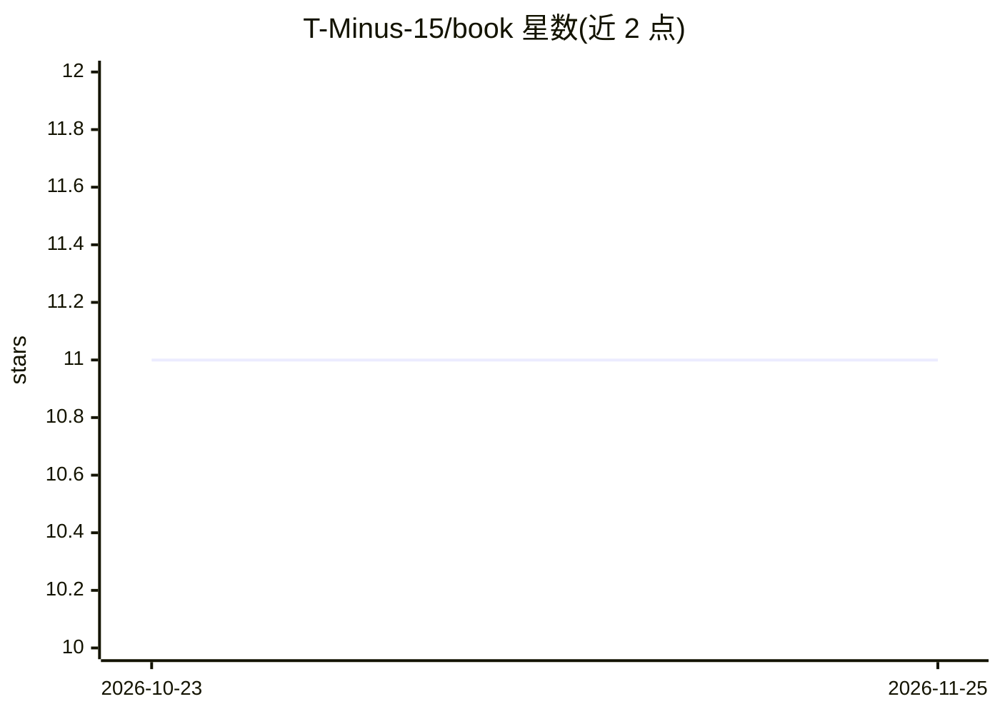

# T-Minus-15/book

⭐ 11 · Python · NOASSERTION · 推送 2026-11-04 · [GitHub](https://github.com/T-Minus-15/book) · 个人维护

**面向开发团队的 Agile+DevOps 实施方法书籍（草稿）**

T-Minus-15 方法论以书籍形式给出敏捷（Scrum）与 DevOps 的具体实施细节：团队角色、估算方式、会议安排、工作项元数据等。原为作者团队成员与客户的内部资料，现已开放给其他团队阅读。内容以 AsciiDoc 编写，可经 book.adoc 编译，并作为 Amazon Kindle 出版版的源文件；社区可通过 PR 贡献，达到一定数量可成为共同作者。书籍仍为草稿，内容可能变动。主题标签含 ai，但可见正文中未见 AI 相关内容。

## 筛选速览

| 维度 | 判定 | 备注 |
|---|---|---|
| AI 角色 | `ai-knowledge` | 知识聚合/清单类 |
| 许可风险 | `none` | NOASSERTION |
| 部署形态 | `None` |  |
| 模型依赖 | — | README 未给出锁定关系 |
| 硬件要求 | — | 无带数字的原话,不猜 |
| 安装摩擦 | `low` | 无编译、无系统依赖或容器化 |
| 成熟度 | `idea` | |

## 能力要点

- 给出 Agile/Scrum 与 DevOps 的具体落地实现细节
- 包含 11 章正文与 9 个附录（工作项元数据、会议等）
- AsciiDoc 格式编写，经 book.adoc 编译成书
- 以 CC 许可开放，接受 PR 贡献并设共同作者机制

## 适用场景

- 开发团队参考具体做法落地 Scrum 与 DevOps
- IT 管理者了解团队角色、估算与会议的组织方式
- 作为团队培训与教育素材（仓库还收录演示文稿）

## 场景标签

`教程课程` · 领域:学习与行业

## 证据(README 行号)

> L5: The T-Minus-15 Methodology gives specific implementation details for development teams that want to apply the princi
> L7: Whilst you can read about DevOps and Agile framework (at the time of writing, over 600 and 8,000 results respectivel
> L29: To compile this book, see book.adoc.

## 星数曲线

2026-10-23 11 → 2026-11-25 11（+0）

---
*卡片 v1 · prompt 1.4 · 生成 2026-11-18 · 置信度 high · 依据 README sha `74b119223a85` · [字段定义](../../DATASET.md)*
