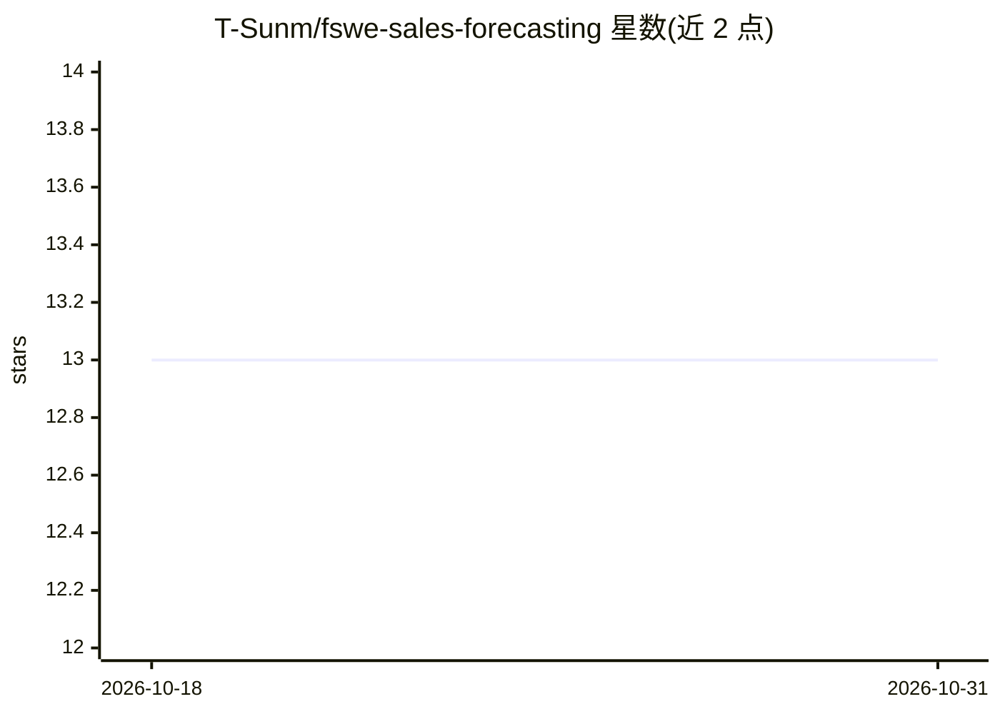

# T-Sunm/fswe-sales-forecasting

⭐ 13 · Jupyter Notebook · 推送 2026-03-26 · [GitHub](https://github.com/T-Sunm/fswe-sales-forecasting) · 个人维护

**面向天气敏感零售需求的端到端销量预测与 XAI 系统**

解决 Kaggle Walmart Stormy Weather 竞赛问题的完整销量预测管线：PostgreSQL 作为数据仓库，dbt 做结构化 SQL 转换，Optuna 进行超参数优化并训练 LightGBM 模型，FastAPI 提供推理端点，Streamlit 展示可解释 AI（XAI）可视化。部署通过 docker compose 启动数据库、后端与前端，训练使用 uv 运行 Python 3.10+ 脚本。适合需要可复现 MLOps 管线与预测解释界面的零售分析开发者。

## 筛选速览

| 维度 | 判定 | 备注 |
|---|---|---|
| AI 角色 | `ai-native` | 本体是模型或模型工具 |
| 许可风险 | `none` | — |
| 部署形态 | `self-host` | docker 或自建部署 |
| 模型依赖 | — | README 未给出锁定关系 |
| 硬件要求 | — | 无带数字的原话,不猜 |
| 安装摩擦 | `low` | 无编译、无系统依赖或容器化 |
| 成熟度 | — | 结构信号不足 |

## 能力要点

- PostgreSQL + dbt 构建 dimensional 数据模型
- Optuna 超参数优化训练 LightGBM 模型
- FastAPI 推理端点（/docs）与 Streamlit XAI 可视化仪表盘
- docker compose 一键启动数据库、后端（8000）与前端（8501）

## 适用场景

- 预测恶劣天气对天气敏感商品销量的影响
- 搭建带数据仓库与 MLOps 流程的销量预测系统
- 通过可视化界面查看预测结果的特征解释

## 场景标签

`MLOps` · 领域:训练与推理

## 证据(README 行号)

> L5: This repository defines an integrated sales forecasting system resolving the Walmart Recruiting II Sales in Stormy W
> L7: The technical implementation unifies a centralized data warehouse methodology with a structured Machine Learning Ope

## 星数曲线

2026-10-18 13 → 2026-10-31 13（+0）

---
*卡片 v1 · prompt 1.4 · 生成 2026-10-31 · 置信度 high · 依据 README sha `4a0a24751e56` · [字段定义](../../DATASET.md)*
