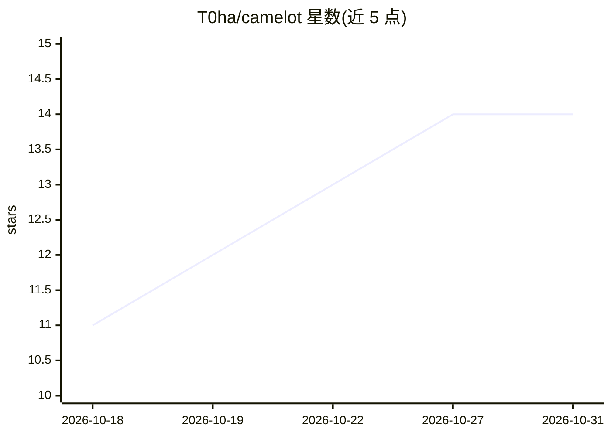

# T0ha/camelot

⭐ 14 · Elixir · GPL-2.0 · 推送 2026-10-29 · [GitHub](https://github.com/T0ha/camelot) · [官网](https://camelotai.tech) · 个人维护

**给开发团队的看板式 AI 编码代理编排器**

基于 Elixir/Phoenix LiveView 的自托管应用：在看板上创建或从 GitHub Issues 同步任务，由 Claude Code 或 Codex CLI 代理领取任务、生成计划，经人工批准后执行并开 PR，支持实时 WebSocket 会话流、PR 评审与 CI 失败处理。提供 6 阶段状态机、按项目的提示词模板（变量插值）、CLI 工具白名单、优先级调度与魔法链接登录。运行需 Elixir/OTP、PostgreSQL 及至少一种代理 CLI，通过 git clone 或 docker compose 部署。

## 筛选速览

| 维度 | 判定 | 备注 |
|---|---|---|
| AI 角色 | `ai-ecosystem` | LLM/agent 周边工具 |
| 许可风险 | `viral` | GPL-2.0 |
| 部署形态 | `self-host` | docker 或自建部署 |
| 模型依赖 | locked-api |  |
| 硬件要求 | — | 无带数字的原话,不猜 |
| 安装摩擦 | `low` | 无编译、无系统依赖或容器化 |
| 成熟度 | — | 结构信号不足 |

## 能力要点

- 看板 6 阶段工作流与优先级任务调度，可并行运行 Claude Code 与 Codex 代理
- 代理先出计划、人工批准后才执行并开 PR 的人机协同流程
- 按项目的提示词模板（{{variable}} 插值）与 CLI 工具白名单
- 自托管：代码留在本地基础设施，PostgreSQL 自有服务器

## 适用场景

- 把编码任务交给 AI 代理执行并保留人工审批控制
- 多项目并行调度多个编码代理并实时查看会话输出
- 与 GitHub Issues/PR/CI 集成，PR 合并后任务自动完成

## 场景标签

`编码 Agent` `Agent 框架` · 领域:Agent 开发

## 证据(README 行号)

> L24: 2. **AI agents pick up tasks**, write a plan, and wait for your approval
> L32: - **Multi-agent coordination** — Run Claude Code and Codex agents in parallel across projects. Priority-based task 
> L130: - **Agent CLI** configs wrap a CLI tool (Claude Code or Codex) — executable, args, parser, runner image — configur

## 星数曲线

2026-10-18 11 → 2026-10-31 14（+3）

---
*卡片 v1 · prompt 1.4 · 生成 2026-10-31 · 置信度 high · 依据 README sha `7cf54d426ef6` · [字段定义](../../DATASET.md)*
