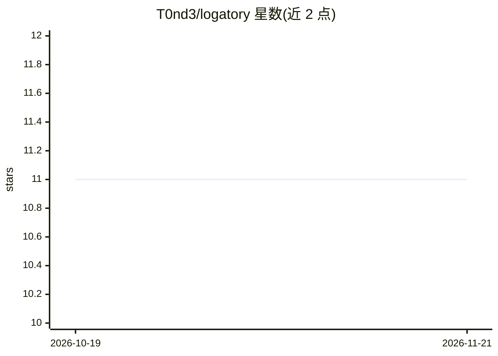

# T0nd3/logatory

⭐ 11 · Python · Apache-2.0 · 推送 2026-06-13 · [GitHub](https://github.com/T0nd3/logatory) · [官网](https://pypi.org/project/logatory/) · 个人维护

**本地日志分析 CLI：PII 脱敏、威胁/异常检测、LLM 解读**

在本机运行的日志分析工具：自动识别 Syslog、Nginx/Apache、JSON Lines、CEF 等多种格式，扫描时对邮箱、IP、信用卡号等 PII 做确定性假名化或掩码；通过 YAML 规则引擎和 Sigma 规则转换进行威胁检测，用 Z-score 统计基线做异常检测，并可接 LLM 解释发现、汇总错误与 RAG 问答。提供 CLI、FastAPI+HTMX Web 仪表盘和带 Bearer 认证的 REST API，发现结果可持久化到 SQLite 并导出 Markdown 报告。核心仅依赖 PyYAML 与 typer，Web/Docker/Claude 等为可选扩展集。

## 筛选速览

| 维度 | 判定 | 备注 |
|---|---|---|
| AI 角色 | `ai-native` | 本体是模型或模型工具 |
| 许可风险 | `permissive` | Apache-2.0 |
| 部署形态 | `self-host` | docker 或自建部署 |
| 模型依赖 | local-ok | 支持本地模型 |
| 硬件要求 | — | 无带数字的原话,不猜 |
| 安装摩擦 | `low` | 无编译、无系统依赖或容器化 |
| 成熟度 | — | 结构信号不足 |

## 能力要点

- 10+ 种日志格式自动检测，读取本地文件、gzip 与 .xlsx
- PII 确定性假名化：同一 IP 恒定映射同一 token，关联性保留
- YAML 规则引擎 + Sigma 规则转换 + Z-score 异常检测
- 多来源适配：Docker、Kubernetes、systemd journal、S3、CloudWatch、GCP、SSH、Loki、Graylog、syslog 监听

## 适用场景

- 在本地扫描服务器日志并自动脱敏 PII 后做安全排查
- 从 Docker/Kubernetes/云日志服务直接拉取日志做异常检测
- 对扫描出的高危发现让 LLM 生成解释并导出安全报告

## 场景标签

`网络安全` · 领域:学习与行业

## 证据(README 行号)

> L8: **Local log analysis with PII redaction, rule-based threat detection, anomaly detection, LLM-powered insights, and a
> L34: |**LLM integration**|Ollama (default), Claude, OpenAI-compatible APIs; explain findings, summarize errors, RAG Q&A|

## 星数曲线

2026-10-19 11 → 2026-11-21 11（+0）

---
*卡片 v1 · prompt 1.4 · 生成 2026-11-18 · 置信度 high · 依据 README sha `7404c49df788` · [字段定义](../../DATASET.md)*
