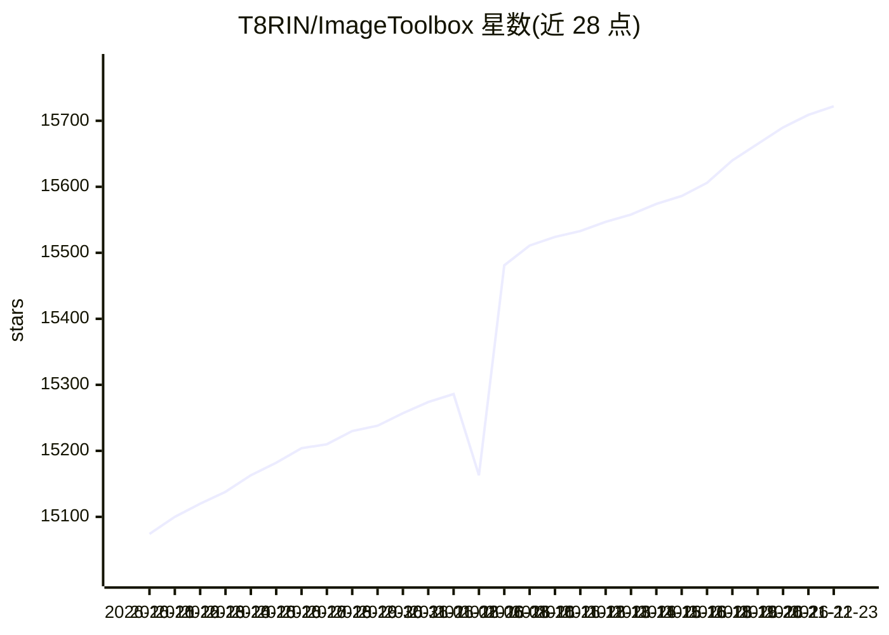

# T8RIN/ImageToolbox

⭐ 15,722 · Kotlin · Apache-2.0 · 推送 2026-11-21 · [GitHub](https://github.com/T8RIN/ImageToolbox) · 个人维护 · 中文 README

**面向 Android 用户的高级图像编辑应用，含裁剪、滤镜、OCR 等功能**

基于 Kotlin 与 Jetpack Compose 的 Android 图像编辑应用，提供批量处理、滤镜链（600+ 种滤镜）、裁剪、EXIF 编辑、背景擦除、OCR、红眼去除、透视校正、接缝裁剪等功能。分发渠道包括 GitHub Releases、Google Play、F-Droid 与 Obtainium；提供 FOSS 与 Market 两个版本，二者在二维码扫描、自动背景移除、文档扫描所用的实现（Zxing/OpenCV/ONNX 与 MlKit）及是否含分析组件上有差异。可从源码用 Gradle 构建。

## 筛选速览

| 维度 | 判定 | 备注 |
|---|---|---|
| AI 角色 | `ai-enhanced` | 去掉 AI 部分产品仍成立 |
| 许可风险 | `permissive` | Apache-2.0 |
| 部署形态 | `None` |  |
| 模型依赖 | — | README 未给出锁定关系 |
| 硬件要求 | — | 无带数字的原话,不猜 |
| 安装摩擦 | `low` | 无编译、无系统依赖或容器化 |
| 成熟度 | — | 结构信号不足 |

## 动量与使用信号

- 维护:`active` — 距上次 push 1.5 天,年发版 70,181 位贡献者
- 涨星:近 1 天 **+22**(自 20261016 起算)
- 平台:ANDROID · 协议:—

## 能力要点

- 600+ 种滤镜与滤镜链组合，含色调映射、抖动、像素化等类别
- 批量处理、EXIF 编辑、OCR、背景移除、文档扫描
- FOSS 与 Market 双版本：分别使用 OpenCV/ONNX/Zxing 与 MlKit 实现
- 支持 F-Droid、Obtainium 等多种分发渠道

## 适用场景

- 在手机上批量修图和给照片加滤镜
- 擦除照片背景或扫描文档
- 查看和编辑图片的 EXIF 元数据

## 场景标签

`OCR` `图像视频处理` · 领域:感知与多模态

## 证据(README 行号)

> L42: ImageToolbox is a versatile image editing tool designed for efficient photo manipulation. It allows
> L43: users to crop, apply filters, edit EXIF data, erase backgrounds, and even enhance images with AI.
> L94: |Auto Background Remover|ONNX|MlKit|

## 星数曲线

2026-10-21 15,074 → 2026-11-23 15,722（+648）

---
*卡片 v1 · prompt 1.4 · 生成 2026-11-22 · 置信度 high · 依据 README sha `084f393bc6de` · [字段定义](../../DATASET.md)*
