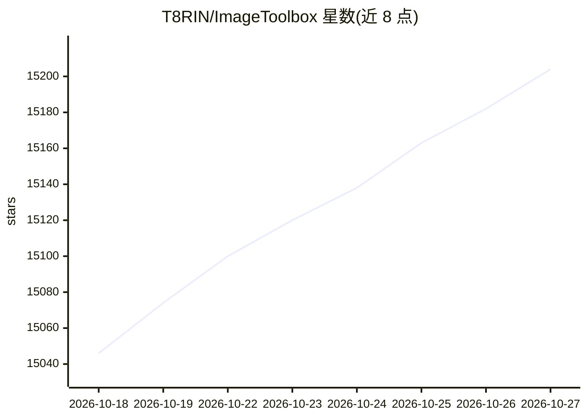

# T8RIN/ImageToolbox

⭐ 15,204 · Kotlin · Apache-2.0 · 推送 2026-10-26 · [GitHub](https://github.com/T8RIN/ImageToolbox) · 个人维护

**Android 图像编辑应用：裁剪、500+滤镜、EXIF、抠图、OCR**

基于 Kotlin/Jetpack Compose 的 Android 图像编辑工具，覆盖裁剪、绘图、EXIF 编辑、批量处理、500+ 种滤镜链（模糊、抖动、色调映射、像素化、取证分析等）。AI 相关功能包括自动背景擦除、文档扫描与 OCR。提供 FOSS 与 Market 双发行渠道：F-Droid 版使用 ZXing/ONNX/OpenCV 等开源组件，Google Play 版使用 MlKit 并含分析组件。安装方式为 Google Play/F-Droid/Releases APK，或 Gradle 源码构建。

## 筛选速览

| 维度 | 判定 | 备注 |
|---|---|---|
| AI 角色 | `ai-enhanced` | 去掉 AI 部分产品仍成立 |
| 许可风险 | `permissive` | Apache-2.0 |
| 部署形态 | `None` |  |
| 模型依赖 | — | README 未给出锁定关系 |
| 硬件要求 | — | 无带数字的原话,不猜 |
| 安装摩擦 | `low` | 无编译、无系统依赖或容器化 |
| 成熟度 | — | 结构信号不足 |

## 动量与使用信号

- 维护:`active` — 距上次 push 1.5 天,年发版 70,181 位贡献者
- 涨星:近 1 天 **+22**(自 20261016 起算)
- 平台:ANDROID · 协议:—

## 能力要点

- 500+ 种滤镜与滤镜链、批量处理
- 自动背景擦除（FOSS 版用 ONNX，Market 版用 MlKit）
- EXIF 编辑、QR 扫描、文档扫描、图像取证分析（ELA/复制移动检测）
- 多渠道发布：Google Play/F-Droid/GitHub Releases/Obtainium

## 适用场景

- 手机上批量编辑与压缩图片
- 去除图片背景或扫描文档、识别文字
- 编辑或清除照片 EXIF 元数据
- 对图片应用艺术滤镜与风格化效果

## 场景标签

`图像视频处理` `OCR` · 领域:感知与多模态

## 证据(README 行号)

> L42: ImageToolbox is a versatile image editing tool designed for efficient photo manipulation. It allows
> L43: users to crop, apply filters, edit EXIF data, erase backgrounds, and even enhance images with AI.
> L94: |Auto Background Remover|ONNX|MlKit|

## 星数曲线

2026-10-18 15,046 → 2026-10-27 15,204（+158）

---
*卡片 v1 · prompt 1.4 · 生成 2026-10-20 · 置信度 high · 依据 README sha `7c979772c297` · [字段定义](../../DATASET.md)*
