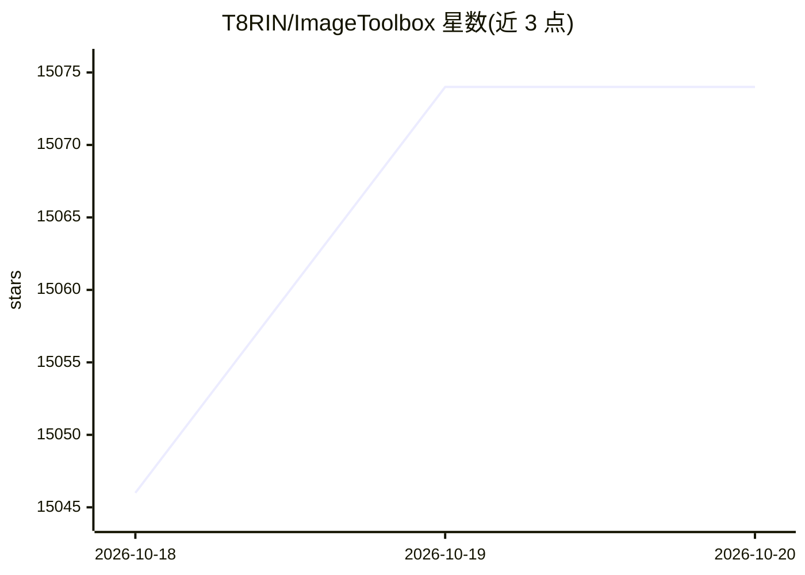

# T8RIN/ImageToolbox

⭐ 15,074 · Kotlin · Apache-2.0 · 推送 2026-10-19 · [GitHub](https://github.com/T8RIN/ImageToolbox) · 个人维护 · 中文 README

**Android 用户的开源高级图像编辑工具，覆盖裁剪到 OCR 多种处理**

基于 Kotlin 与 Jetpack Compose 构建的 Android 图像编辑应用，提供裁剪、滤镜、EXIF 编辑、背景擦除、OCR 与批量处理等功能，支持 500 多种滤镜的链式叠加。分发上提供 FOSS 与 Market 两个版本：FOSS 版使用 ONNX、OpenCV、Zxing 等开源实现且不含 Google 依赖与分析组件，Market 版改用 MlKit 并包含分析组件。安装途径包括 GitHub Releases、Google Play、F-Droid 与 Obtainium 的 APK，也可克隆仓库用 Gradle 构建。

## 筛选速览

| 维度 | 判定 | 备注 |
|---|---|---|
| AI 角色 | `ai-enhanced` | 去掉 AI 部分产品仍成立 |
| 许可风险 | `permissive` | Apache-2.0 |
| 部署形态 | `None` |  |
| 模型依赖 | — | README 未给出锁定关系 |
| 硬件要求 | — | 无带数字的原话,不猜 |
| 安装摩擦 | `low` | 无编译、无系统依赖或容器化 |
| 成熟度 | — | 结构信号不足 |

## 动量与使用信号

- 维护:`active` — 距上次 push 1.5 天,年发版 70,181 位贡献者
- 涨星:近 1 天 **+22**(自 20261016 起算)
- 平台:ANDROID · 协议:—

## 能力要点

- 500+ 滤镜链式叠加处理与批量处理
- 自动背景移除：FOSS 版用 ONNX，Market 版用 MlKit
- EXIF 数据编辑与 OCR
- FOSS 版不含 Google 依赖与分析组件，含 OpenCV 文档扫描

## 适用场景

- 在 Android 手机上批量裁剪、加滤镜、处理照片
- 擦除图片背景或扫描文档
- 查看和编辑图片的 EXIF 元数据
- 从 F-Droid 安装无 Google 依赖的纯开源版本

## 场景标签

`图像视频处理` `OCR` · 领域:感知与多模态

## 证据(README 行号)

> L42: ImageToolbox is a versatile image editing tool designed for efficient photo manipulation. It allows
> L43: users to crop, apply filters, edit EXIF data, erase backgrounds, and even enhance images with AI.
> L89: # ⚔️ FOSS vs MARKET

## 星数曲线

2026-10-18 15,046 → 2026-10-20 15,074（+28）

---
*卡片 v1 · prompt 1.4 · 生成 2026-10-18 · 置信度 high · 依据 README sha `b3ee42154229` · [字段定义](../../DATASET.md)*
