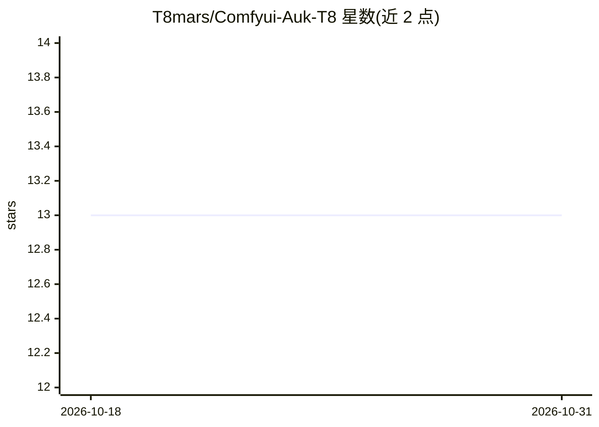

# T8mars/Comfyui-Auk-T8

⭐ 13 · Python · NOASSERTION · 推送 2026-09-30 · [GitHub](https://github.com/T8mars/Comfyui-Auk-T8) · [官网](https://huggingface.co/t8star/Auk-Comfy) · 个人维护 · 中文 README

**在 ComfyUI 内运行 AuK 语音生成与编辑的自定义节点包**

面向 ComfyUI 用户的独立自定义节点包，在 ComfyUI 进程内直接加载 AuK、AuK-Flash 与 Qwen2.5-Omni-3B，无需 AuK Local 或本地服务。提供模型加载节点、17 个中文任务入口（指令 TTS、零样本语音克隆、语音/歌词编辑、音高语速音量情感音色编辑、去口音、耳语转换、增强修复、人声分离等）及音频裁剪节点，输出标准 ComfyUI AUDIO 与元数据。限制：源/输出音频各限 30 秒；推荐 NVIDIA CUDA bf16（24 GB GPU、48 GB 内存）；另有独立的 AuK Local Windows 一键包（含模型与 Python）。

## 筛选速览

| 维度 | 判定 | 备注 |
|---|---|---|
| AI 角色 | `ai-native` | 本体是模型或模型工具 |
| 许可风险 | `none` | NOASSERTION |
| 部署形态 | `desktop` | 安装包/桌面程序 |
| 模型依赖 | — | README 未给出锁定关系 |
| 硬件要求 | — | 无带数字的原话,不猜 |
| 安装摩擦 | `medium` | 含编译或系统依赖之一 |
| 成熟度 | — | 结构信号不足 |

## 能力要点

- 17 个中文任务入口覆盖 16 个上游低层任务
- 直接在 ComfyUI 进程内加载模型，无需 AuK Local 或服务令牌
- 内置 Silero VAD、LUFS 响度处理与自动时长适配规则
- 提供全部任务的拖入即用示例工作流

## 适用场景

- 在 ComfyUI 工作流中做零样本语音克隆与指令 TTS
- 对语音做音高、语速、情感、音色等编辑与去口音
- 做人声分离与目标说话人提取

## 场景标签

`语音合成` · 领域:内容生成

## 证据(README 行号)

> L3: Run AuK speech generation and editing directly inside ComfyUI
> L13: - **AuK Model Loader** defaults to the higher-quality AuK Base and can switch to the speed-oriented AuK-Flash. Comf
> L17: Tasks include instruction TTS, zero-shot voice cloning, speech and lyric editing, pitch/speed/volume/emotion/timbre

## 星数曲线

2026-10-18 13 → 2026-10-31 13（+0）

---
*卡片 v1 · prompt 1.4 · 生成 2026-10-31 · 置信度 mid · 依据 README sha `645ce6d6d80f` · [字段定义](../../DATASET.md)*
