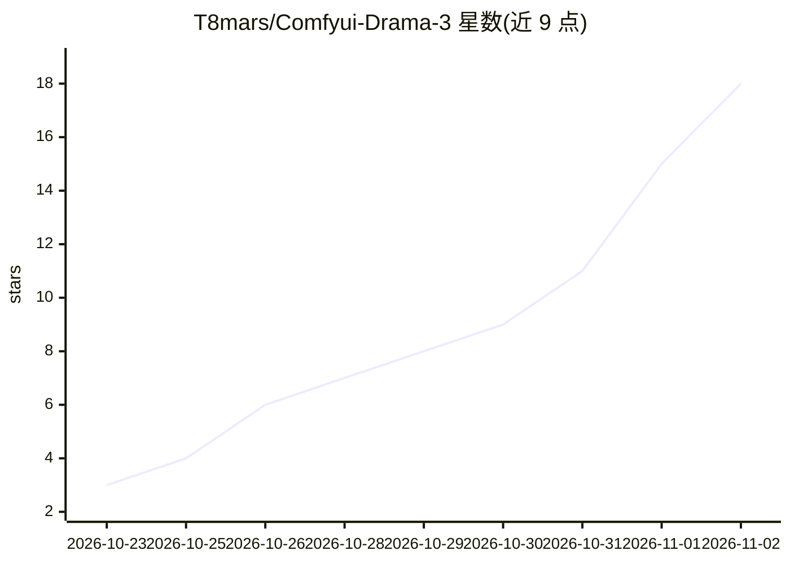

# T8mars/Comfyui-Drama-3

⭐ 18 · Python · GPL-3.0 · 推送 2026-10-30 · [GitHub](https://github.com/T8mars/Comfyui-Drama-3) · [官网](https://huggingface.co/t8star/Drama-3-Comfy) · 个人维护 · 中文 README

**DRAMA-3 本地语音创作工作室与 ComfyUI 原生节点集**

面向 Fish Audio DRAMA-3 的本地语音创作工具，由 T8star 提供：一个 Windows 整合包形式的本地 Studio（选角、多 take 表演、导演修订、infill、录音准备、导出 WAV/分轨/SRT），以及 30 个 ComfyUI 原生节点（四种 Scene 模式、长文本、流式、Session、转录与词对齐），推理直接在 ComfyUI 内运行。语音克隆基于参考音频条件化，无需训练；附带本地 ASR（Qwen3-ASR、R2T2）、VAD 与可选 CAM++ 说话人模型。限制：依赖版本固定（Transformers 4.57.1、Torch 2.8 + CUDA 12.8 目标环境），速度/表演质量不做保证。

## 筛选速览

| 维度 | 判定 | 备注 |
|---|---|---|
| AI 角色 | `ai-native` | 本体是模型或模型工具 |
| 许可风险 | `viral` | GPL-3.0 |
| 部署形态 | `desktop` | 安装包/桌面程序 |
| 模型依赖 | — | README 未给出锁定关系 |
| 硬件要求 | — | 无带数字的原话,不猜 |
| 安装摩擦 | `medium` | 含编译或系统依赖之一 |
| 成熟度 | — | 结构信号不足 |

## 能力要点

- 参考音频原生条件化语音克隆，无需训练
- 30 个 ComfyUI 原生节点 + 19 个画布工作流，ComfyUI 内直接推理
- Director 修订、infill、多 take 试听与锁定的创意项目管理
- 本地 ASR/对齐/VAD/说话人建议（Qwen3-ASR、R2T2、FireRedVAD、可选 CAM++）

## 适用场景

- 为剧本/配音项目用参考音频生成角色语音并管理多 take
- 在 ComfyUI 画布中搭建 DRAMA-3 语音生成工作流
- 录音后自动转录、分段并提取语音参考版本

## 场景标签

`语音合成` `语音识别` · 领域:内容生成

## 证据(README 行号)

> L5: A local voice creation studio and native ComfyUI nodes for Fish Audio DRAMA-3, by T8star. Built with Fish Audio.
> L55: **30 native V3 nodes**, standard `AUDIO`, and **19 canvas workflow JSONs**. Inference runs directly in ComfyUI with

## 星数曲线

2026-10-23 3 → 2026-11-02 18（+15）

---
*卡片 v1 · prompt 1.4 · 生成 2026-10-31 · 置信度 high · 依据 README sha `e318030c0db9` · [字段定义](../../DATASET.md)*
