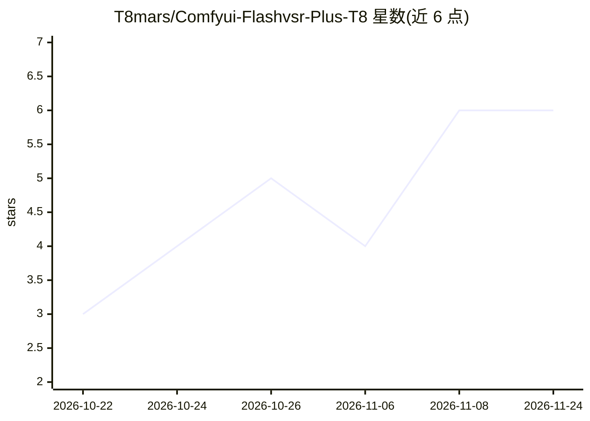

# T8mars/Comfyui-Flashvsr-Plus-T8

⭐ 6 · Python · Apache-2.0 · 推送 2026-10-15 · [GitHub](https://github.com/T8mars/Comfyui-Flashvsr-Plus-T8) · [官网](https://huggingface.co/t8star/Flashvsr-Plus-Comfy) · 个人维护 · 中文 README

**给 ComfyUI 用户接入 FlashVSR+ 视频与单图超分节点**

将 FlashVSR+ 接入 ComfyUI 的自定义节点集：提供 Model Loader、Upscale Video、Upscale Frames 与 Options 四类节点，支持原生 VIDEO/IMAGE 输入、音频与帧率保留、分段解码、INT8 ConvRot 权重与 BF16/FP16 精度，模型可自动下载至本地目录。适用于 NVIDIA CUDA GPU；INT8 需 Comfy Kitchen >=0.2.35，Windows 的 Triton 需匹配现有 PyTorch 版本。默认 turbo/int8_convrot/tiny 组合已通过 45 项回归与 1080p 实测验证；小字与平色图表不保证保真，透明通道需单独保留。

## 筛选速览

| 维度 | 判定 | 备注 |
|---|---|---|
| AI 角色 | `ai-native` | 本体是模型或模型工具 |
| 许可风险 | `permissive` | Apache-2.0 |
| 部署形态 | `library` | 以包/库形式分发 |
| 模型依赖 | — | README 未给出锁定关系 |
| 硬件要求 | — | 无带数字的原话,不猜 |
| 安装摩擦 | `medium` | 含编译或系统依赖之一 |
| 成熟度 | — | 结构信号不足 |

## 能力要点

- 原生 VIDEO 输入输出，增量读取与编码，保留音频、帧率与上游剪辑
- INT8 ConvRot 预转换权重（每个 DiT 约 1.45 GB），减少权重显存
- 注意力支持 BSA / Triton / SDPA，按可用性自动选择
- 单图工作流支持 PNG/JPEG 静态图放大与带工作流结果复现

## 适用场景

- 在 ComfyUI 工作流中对视频做超分辨率放大
- 对单张照片做 4× 放大与色彩校正
- 长视频分段解码处理以降低整批内存占用

## 场景标签

`图像视频处理` · 领域:感知与多模态

## 证据(README 行号)

> L1: # FlashVSR+ T8 · ComfyUI 视频与单图超分辨率
> L5: 将 FlashVSR+ 接入 ComfyUI，支持原生 VIDEO / IMAGE、音频保留、分段处理与 INT8 ConvRot。适用于 NVIDIA CUDA GPU。
> L31: |Upscale Video|原生 VIDEO 输入输出，增量读取和编码|

## 星数曲线

2026-10-22 3 → 2026-11-24 6（+3）

---
*卡片 v1 · prompt 1.4 · 生成 2026-11-20 · 置信度 high · 依据 README sha `61f7f5a0fb4f` · [字段定义](../../DATASET.md)*
