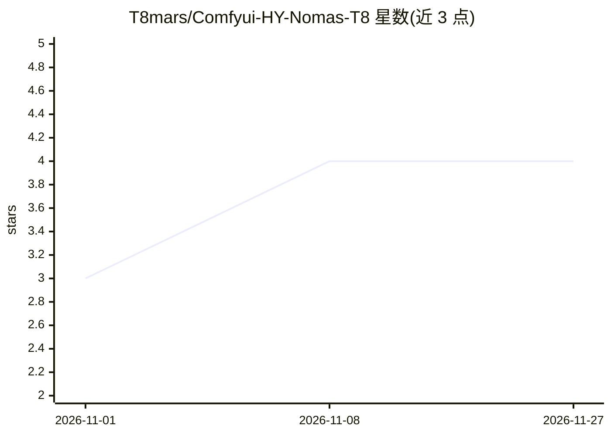

# T8mars/Comfyui-HY-Nomas-T8

⭐ 4 · Python · GPL-3.0 · 推送 2026-10-29 · [GitHub](https://github.com/T8mars/Comfyui-HY-Nomas-T8) · [官网](https://huggingface.co/t8star/HY-Nomas-Comfy) · 个人维护 · 中文 README

**在 ComfyUI 中原生运行 Hy-Nomas 视频世界模型的节点包**

为 ComfyUI 提供原生 Hy-Nomas 视频世界模型节点：支持文字或图片起始、分段续接、相机轨迹控制与键盘交互生成，通过标准 KSampler 采样，模型与历史缓存由宿主管理。包含 15 个节点与 6 个工作流，T8 增加CPU KV 档案预算、占用统计、缓存清理与失败状态回滚。依赖宿主 ComfyUI 与 PyTorch，实测环境为 Windows/NVIDIA 24GB 显存，需自行下载约 28GB 模型文件。派生自上游项目，派生代码保留 GPL-3.0，其中 PixelUMM 解码器仅限非商业研究与评估。

## 筛选速览

| 维度 | 判定 | 备注 |
|---|---|---|
| AI 角色 | `ai-native` | 本体是模型或模型工具 |
| 许可风险 | `viral` | GPL-3.0 |
| 部署形态 | `library` | 以包/库形式分发 |
| 模型依赖 | — | README 未给出锁定关系 |
| 硬件要求 | `gpu-24g` | |
| 安装摩擦 | `low` | 无编译、无系统依赖或容器化 |
| 成熟度 | — | 结构信号不足 |

## 能力要点

- 15 个原生节点与 6 个画布工作流，覆盖图片起始、相机控制与键盘交互
- INT8/FP8 量化推理，支持显存与 CPU 历史预算管理
- 标准 KSampler 直接采样，缓存清理与失败状态回滚
- 通过 ComfyUI-Manager 或 Git URL 安装

## 适用场景

- 在 ComfyUI 中生成 Hy-Nomas 视频世界模型内容
- 通过图片起始帧与相机轨迹控制视频生成
- 在 24GB 显存设备上控制内存占用进行长分段续接

## 场景标签

`视频生成` `模型量化` · 领域:内容生成

## 证据(README 行号)

> L5: 在 ComfyUI 中原生运行 Hy-Nomas 视频世界模型：文字或图片起始、分段续接、相机控制与键盘交互。标准 KSampler 直接采样，模型与历史缓存由宿主管理。
> L53: 本包包含 **15 个原生节点、6 个画布工作流**。T8 增加 CPU KV 档案预算、占用统计、缓存清理，以及取消/失败后的状态回滚。默认 12GiB 档案预算只限制 CPU 历史，不代表总 RAM 或显存上限；长续接应留意占

## 星数曲线

2026-11-01 3 → 2026-11-27 4（+1）

---
*卡片 v1 · prompt 1.4 · 生成 2026-11-26 · 置信度 high · 依据 README sha `9b1597ba7ea9` · [字段定义](../../DATASET.md)*
