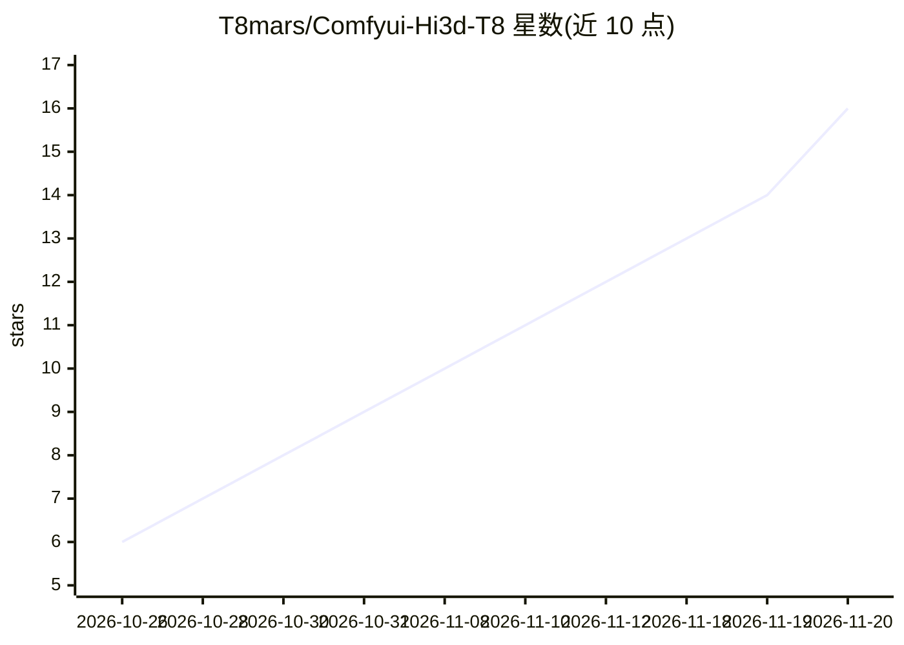

# T8mars/Comfyui-Hi3d-T8

⭐ 16 · Python · NOASSERTION · 推送 2026-11-08 · [GitHub](https://github.com/T8mars/Comfyui-Hi3d-T8) · [官网](https://huggingface.co/t8star/Hi3d-Comfy) · 个人维护 · 中文 README

**给 ComfyUI 与本地工作台用户提供 3D 几何精细化的节点与工具**

包含两部分：ComfyUI 自定义节点（Hi3D Model Loader / Load Mesh / Refine）使用官方 Hi3D 模型对同物体的参考图+粗网格做几何精细化，仅交换 MESH 数据并输出 GLB；独立的 Windows 本地工作台支持单图生成几何、多种几何/PBR 引擎（Hunyuan3D-2mv、TRELLIS.2、Idol、UltraTex 等）、统一光照下的结果对比，带自动更新与模型目录管理。核心权重经 Hugging Face 仓库下载，全部模型合计约 122.89GB。

## 筛选速览

| 维度 | 判定 | 备注 |
|---|---|---|
| AI 角色 | `ai-native` | 本体是模型或模型工具 |
| 许可风险 | `none` | NOASSERTION |
| 部署形态 | `desktop` | 安装包/桌面程序 |
| 模型依赖 | — | README 未给出锁定关系 |
| 硬件要求 | — | 无带数字的原话,不猜 |
| 安装摩擦 | `medium` | 含编译或系统依赖之一 |
| 成熟度 | — | 结构信号不足 |

## 能力要点

- 三个 ComfyUI 节点复现 Hi3D 几何精细化，输出 GLB
- 工作台提供 5 种几何与 4 种 PBR 引擎选择
- 支持 Hunyuan3D-2mv 多视图（含三视图）建模
- bundle-manifest.json 记录打包组件，支持自动更新并保留模型/配置

## 适用场景

- 在 ComfyUI 画布流程中对粗网格做参考图驱动的几何精细化
- 本地批量运行图像转 3D 几何与 PBR 贴图流程
- 在统一光照下对比保存的多个 3D 结果

## 场景标签

`图像生成` · 领域:内容生成

## 证据(README 行号)

> L5: **By T8star** — Hi3D V1.0 geometry refinement for ComfyUI, with a separate local 3D workbench.
> L68: The three nodes are **Hi3D Model Loader**, **Hi3D Load Mesh** and **Hi3D Refine**, exchanging native `MESH` values 
> L79: |Hunyuan3D-2mini-Turbo / Hunyuan3D 2.1 / Hunyuan3D-2mv / TRELLIS.2 / Idol|Selectable image-to-geometry engines|Work

## 星数曲线

2026-10-26 6 → 2026-11-20 16（+10）

---
*卡片 v1 · prompt 1.4 · 生成 2026-11-18 · 置信度 high · 依据 README sha `c0d0d76ebf97` · [字段定义](../../DATASET.md)*
