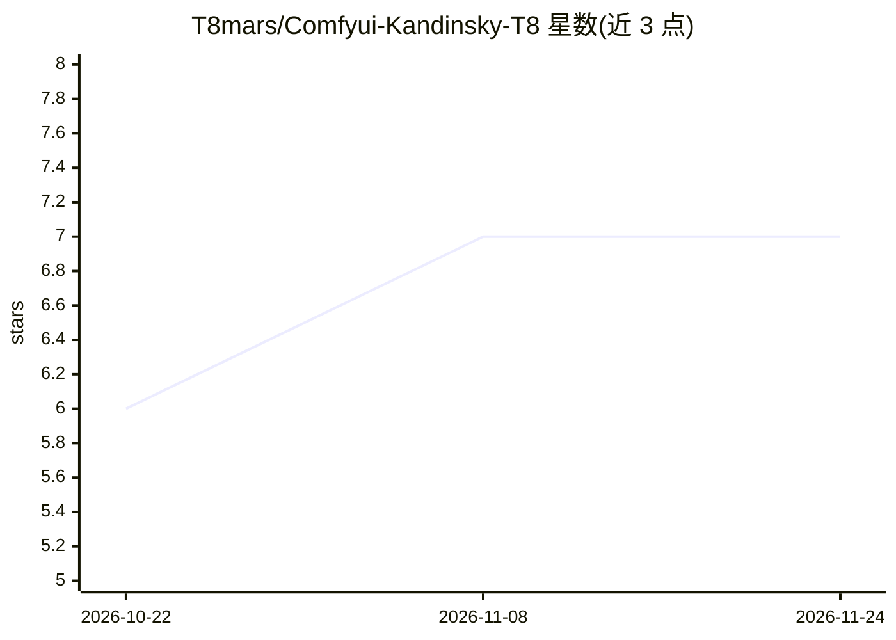

# T8mars/Comfyui-Kandinsky-T8

⭐ — · [GitHub]() · 个人维护 · 中文 README

**为 ComfyUI 提供 Kandinsky 6 视频+音频生成节点**

ComfyUI 自定义节点扩展，接入 Kandinsky 6 模型实现文生视频+音频与图生视频+音频，支持 Lite、Lite distill、Pro distill 三种 INT8 ConvRot 单文件模型，蒸馏模型走 PiFlow 10 步采样。默认输出 864×480、121 帧、24 fps 的带音频 MP4。模型下载含 SHA-256 校验，安装方式为 ComfyUI-Manager 搜索或 git clone 源码。需 ComfyUI 0.39.0+、comfy-kitchen 0.2.37+ 及支持 INT8 Tensor Core 的 NVIDIA CUDA GPU。基于 Kandinsky Lab 官方扩展修改，组件许可证各异（音频解码器为 CC BY-NC 4.0）。

## 筛选速览

| 维度 | 判定 | 备注 |
|---|---|---|
| AI 角色 | `ai-native` | 本体是模型或模型工具 |
| 许可风险 | `permissive` | — |
| 部署形态 | `library` | 以包/库形式分发 |
| 模型依赖 | — | README 未给出锁定关系 |
| 硬件要求 | — | 无带数字的原话,不猜 |
| 安装摩擦 | `medium` | 含编译或系统依赖之一 |
| 成熟度 | — | 结构信号不足 |

## 能力要点

- 文生视频+音频与图生视频+音频双模式
- 三种 INT8 ConvRot 单文件 DiT 模型（3.77–34.97 GB）
- PiFlow 蒸馏采样 10 步、CFG 1
- 工作流内 Download models 按钮下载共享组件并校验 SHA-256

## 适用场景

- 在 ComfyUI 中生成带音频的视频
- 用自己的图片驱动视频+音频生成
- 在 RTX 5090 Laptop 24 GB 等设备上运行 INT8 量化模型

## 场景标签

`视频生成` · 领域:内容生成

## 证据(README 行号)

> L5: Native Kandinsky 6 video and audio generation for ComfyUI, with single-file **INT8 ConvRot** models. Supports text-t
> L11: Requires **ComfyUI 0.39.0+**, **comfy-kitchen 0.2.37+** and an NVIDIA CUDA GPU with INT8 Tensor Core support.

## 星数曲线

2026-10-22 6 → 2026-11-24 7（+1）

---
*卡片 v1 · prompt 1.4 · 生成 2026-11-20 · 置信度 high · 依据 README sha `e2e66a074788` · [字段定义](../../DATASET.md)*
