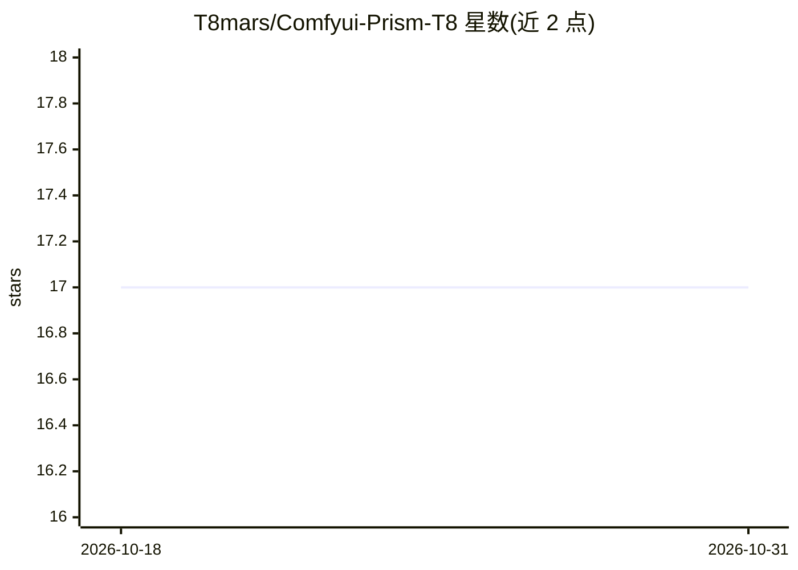

# T8mars/Comfyui-Prism-T8

⭐ 17 · Python · NOASSERTION · 推送 2026-10-07 · [GitHub](https://github.com/T8mars/Comfyui-Prism-T8) · [官网](https://huggingface.co/t8star/Prism-Comfy) · 个人维护 · 中文 README

**腾讯 Prism 视频/音频联合生成的 ComfyUI 原生节点集**

ComfyUI 自定义节点包，将腾讯 Prism 官方双塔视频+音频模型接入 ComfyUI：保留双 DiT 去噪器、跨模态桥接与配对调度器，提供七个独立组件加载器、INT8 ConvRot 量化权重及九份画布工作流；另含 FreeVideo 加速采样器（Light/Standard/High/Max 四档，Light 为 8 步蒸馏）。需要 Python 3.10+、支持 BF16 的 NVIDIA CUDA 环境，完整模型约 38.13 GiB，MP4 输出需 ffmpeg。支持图生视频/音频、独立提示词与 music/sfx/speech 标签，输出 PNG 帧、FLAC 与 MP4。

## 筛选速览

| 维度 | 判定 | 备注 |
|---|---|---|
| AI 角色 | `ai-native` | 本体是模型或模型工具 |
| 许可风险 | `none` | NOASSERTION |
| 部署形态 | `library` | 以包/库形式分发 |
| 模型依赖 | — | README 未给出锁定关系 |
| 硬件要求 | `gpu-8g` | |
| 安装摩擦 | `medium` | 含编译或系统依赖之一 |
| 成熟度 | `idea` | |

## 能力要点

- Prism 原生双塔视频+音频联合生成的 ComfyUI 节点集
- 七个独立 INT8 ConvRot 组件加载器，无需 Diffusers 权重目录
- FreeVideo 加速采样器四档（8 步蒸馏视频采样+音频补偿）
- 九份画布工作流，输出 PNG 帧、48 kHz FLAC 与 H.264/AAC MP4

## 适用场景

- 在 ComfyUI 中用参考图生成带音频的视频
- 通过 music/sfx/speech 标签独立控制视频与音频提示词
- 用 INT8 量化与分块卸载在消费级显卡上运行 Prism 模型
- 自行从官方源权重转换并校验量化模型

## 场景标签

`视频生成` `多模态` · 领域:内容生成

## 证据(README 行号)

> L3: 腾讯 Prism 原生视频与音频联合生成节点。保留官方双塔模型、跨模态桥接和配对调度器，提供七个独立组件加载器、INT8 ConvRot 权重及完整 ComfyUI 画布工作流。
> L65: |01 · I2VA|portable INT8 + SDPA，1280×720、205 帧、50 步|

## 星数曲线

2026-10-18 17 → 2026-10-31 17（+0）

---
*卡片 v1 · prompt 1.4 · 生成 2026-10-29 · 置信度 mid · 依据 README sha `a073c4847f61` · [字段定义](../../DATASET.md)*
