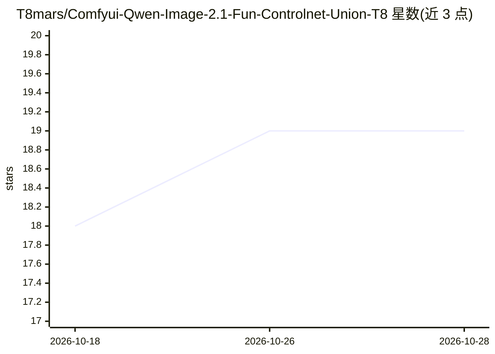

# T8mars/Comfyui-Qwen-Image-2.1-Fun-Controlnet-Union-T8

⭐ 20 · Python · MIT · 推送 2026-09-26 · [GitHub](https://github.com/T8mars/Comfyui-Qwen-Image-2.1-Fun-Controlnet-Union-T8) · [官网](https://registry.comfy.org/nodes/qwen-image-2-1-fun-controlnet-union-t8) · 个人维护 · 中文 README

**ComfyUI 原生节点：为 Qwen Image 2.1 提供 Union ControlNet 控制生图**

面向 ComfyUI 用户与图像生成开发者的自定义节点包：将阿里 PAI 的 Qwen Image 2.1 Fun ControlNet Union 接入 ComfyUI 原生模型管线，单一 Union 权重支持 Canny/Depth/Grayscale/HED/Lineart/MLSD/Pose/Scribble 及掩码局部重绘九种控制模式，附八套控制工作流与参考图编辑节点。限制：控制图需预先准备（节点不做预处理），模型权重为 Qwen Research License 非商业用途。分发包为 GPL-3.0。

## 筛选速览

| 维度 | 判定 | 备注 |
|---|---|---|
| AI 角色 | `ai-ecosystem` | LLM/agent 周边工具 |
| 许可风险 | `permissive` | MIT |
| 部署形态 | `None` |  |
| 模型依赖 | — | README 未给出锁定关系 |
| 硬件要求 | — | 无带数字的原话,不猜 |
| 安装摩擦 | `low` | 无编译、无系统依赖或容器化 |
| 成熟度 | — | 结构信号不足 |

## 能力要点

- 单一 Union checkpoint 支持 9 种控制类型（含掩码重绘）
- 基于 ComfyUI 原生 Qwen Image 2.1 模型与条件管线
- 附 8 套控制工作流、姿态重绘与参考图编辑流程
- 校验 16-block Union checkpoint，提供 SHA256 校验文件与转换脚本

## 适用场景

- 用姿态/边缘/深度图控制 Qwen Image 2.1 的图像生成
- 对照片做参考图引导的编辑与掩码局部重绘
- 在 ComfyUI 中统一管理多种 ControlNet 控制模式

## 场景标签

`图像生成` · 领域:内容生成

## 证据(README 行号)

> L5: Native ComfyUI nodes for Alibaba PAI's Qwen Image 2.1 Fun ControlNet Union. One Union checkpoint supports Canny, Dep
> L26: Install **Qwen Image 2.1 Fun ControlNet Union (T8)** from ComfyUI Manager, or clone this repository into `ComfyUI/c

## 星数曲线

2026-10-18 18 → 2026-10-28 19（+1）

---
*卡片 v1 · prompt 1.4 · 生成 2026-10-28 · 置信度 high · 依据 README sha `cba415f00e31` · [字段定义](../../DATASET.md)*
