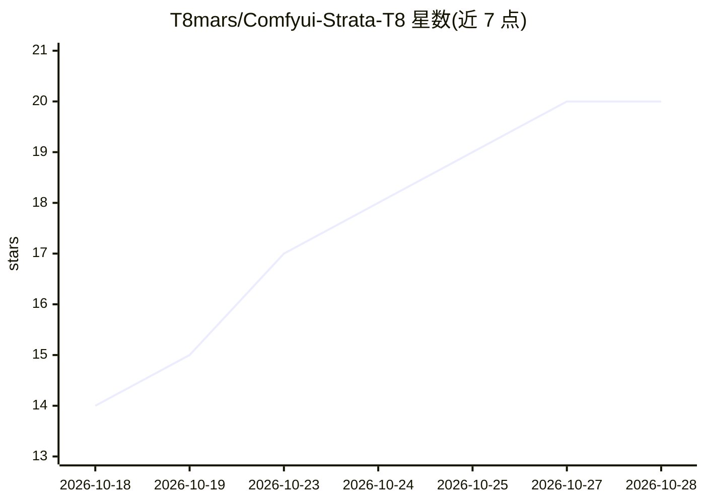

# T8mars/Comfyui-Strata-T8

⭐ 20 · Python · MIT · 推送 2026-10-27 · [GitHub](https://github.com/T8mars/Comfyui-Strata-T8) · 个人维护 · 中文 README

**把本地 Strata 语言/视觉推理接入 ComfyUI 的 14 个自定义节点**

ComfyUI 自定义节点集，通过托管或 external 连接方式调用独立进程的 Strata-T8 运行包（Qwen 系主模型 GGUF + 视觉编码器），在 ComfyUI 内提供提示词生成、结构化分镜 JSON、图片描述/OCR/反推、视频分段采样分析与语音转写（Confucius4-R2T2，时标 SRT）。本仓库仅含节点：不含模型、Python 或推理引擎，需另下 Strata-T8 VisionReady 整合包；同卡模式需确认引擎退出后再交下游绘图。Windows 整合包要求 Windows 10 1903+/11 x64、AVX2、IQ3_S 建议 96GB 以上 RAM，AMD Windows 视觉不支持。

## 筛选速览

| 维度 | 判定 | 备注 |
|---|---|---|
| AI 角色 | `ai-ecosystem` | LLM/agent 周边工具 |
| 许可风险 | `permissive` | MIT |
| 部署形态 | `desktop` | 安装包/桌面程序 |
| 模型依赖 | — | README 未给出锁定关系 |
| 硬件要求 | — | 无带数字的原话,不猜 |
| 安装摩擦 | `medium` | 含编译或系统依赖之一 |
| 成熟度 | — | 结构信号不足 |

## 能力要点

- 14 个节点覆盖文本提示词、结构化分镜、图片/批量视觉、全程视频分析与语音转写
- Strata 独立进程运行，同卡模式推理结束后释放再交给下游绘图节点
- Full Video Analyze 按秒数/帧率自动规划逐段采样（最多 256 段），输出报告、JSON、证据与覆盖率
- ASR 转录带时标对白融合，SRT/VTT 输出，与视觉证据区分

## 适用场景

- 在 ComfyUI 工作流里用本地 LLM 生成/扩写绘图提示词
- 把视频分段采样分析后反推视频生成提示词或提取结构化字段
- 为图片批量生成描述或反推提示词再接绘图模型
- 视频音画联合分析：带时标对白转录后与画面观察合并报告

## 场景标签

`提示工程` `语音识别` `OCR` `图像视频处理` · 领域:Agent 开发

## 证据(README 行号)

> L5: 将 Strata 的本地语言与视觉推理接入 ComfyUI：提示词生成、结构化分镜、图片描述、视频采样分析与批量工作流。Strata 使用独立进程；同卡模式在推理结束后确认引擎退出，再交给下游绘图节点。
> L7: **节点与运行包独立发行。** 本仓库不含模型、Python 或推理引擎；Strata-T8 整合包 提供 Python、依赖、CUDA/HIP 引擎，VisionReady 另含视觉权重与配置。
> L13: Registry 版本审核通过后，在 ComfyUI-Manager 搜索 **Strata-T8**，节点 ID `strata-t8`，Publisher `t8star`。尚未显示时可使用 Release ZIP，或在 `C

## 星数曲线

2026-10-18 14 → 2026-10-28 20（+6）

---
*卡片 v1 · prompt 1.4 · 生成 2026-10-28 · 置信度 high · 依据 README sha `62493471c91c` · [字段定义](../../DATASET.md)*
