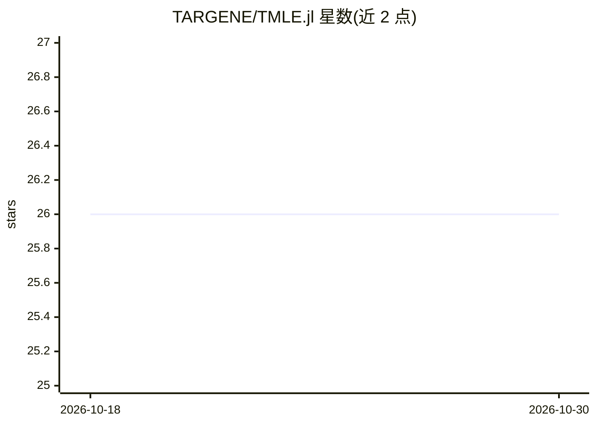

# TARGENE/TMLE.jl

⭐ 26 · Julia · MIT · 推送 2026-09-26 · [GitHub](https://github.com/TARGENE/TMLE.jl) · [官网](https://targene.github.io/TMLE.jl/stable/) · 组织维护

**Julia 因果推断估计库：双稳健的 TMLE 因果效应估计**

Julia 实现的目标最大似然估计（TMLE）统计包：结合机器学习与半参数统计原理，对观察性与实验性研究中的因果参数进行双稳健、有效的估计，用于干预效果分析（如治疗是否改善健康结局、基因变异是否致病）。支持 Julia v1.10 及以上，通过 Pkg 包管理器安装。配套论文发表于 Journal of Open Source Software（2025）。作者团队来自学术机构（Labayle、Ponting、van der Laan 等）。

## 筛选速览

| 维度 | 判定 | 备注 |
|---|---|---|
| AI 角色 | `ai-native` | 本体是模型或模型工具 |
| 许可风险 | `permissive` | MIT |
| 部署形态 | `None` |  |
| 模型依赖 | — | README 未给出锁定关系 |
| 硬件要求 | — | 无带数字的原话,不猜 |
| 安装摩擦 | `low` | 无编译、无系统依赖或容器化 |
| 成熟度 | — | 结构信号不足 |

## 能力要点

- 目标最大似然估计（TMLE）的 Julia 实现
- 双稳健、有效的因果参数估计
- 结合机器学习与半参数统计，支持观察性与实验性研究
- 发表于 JOSS 期刊（DOI: 10.21105/joss.08446）

## 适用场景

- 观察性数据中估计治疗或干预的因果效应
- 高维数据下规避传统回归模型的错误设定问题
- 基因变异与疾病风险的因果效应分析

## 场景标签

 · 领域:统计/因果推断

## 证据(README 行号)

> L12: **TMLE.jl** is a Julia package that implements Targeted Maximum Likelihood Estimation (TMLE), a general framework f
> L10: Causal inference is essential for understanding the effect of interventions in real-world settings, such as determi

## 星数曲线

2026-10-18 26 → 2026-10-30 26（+0）

---
*卡片 v1 · prompt 1.4 · 生成 2026-10-26 · 置信度 high · 依据 README sha `b6f5ffd44baa` · [字段定义](../../DATASET.md)*
