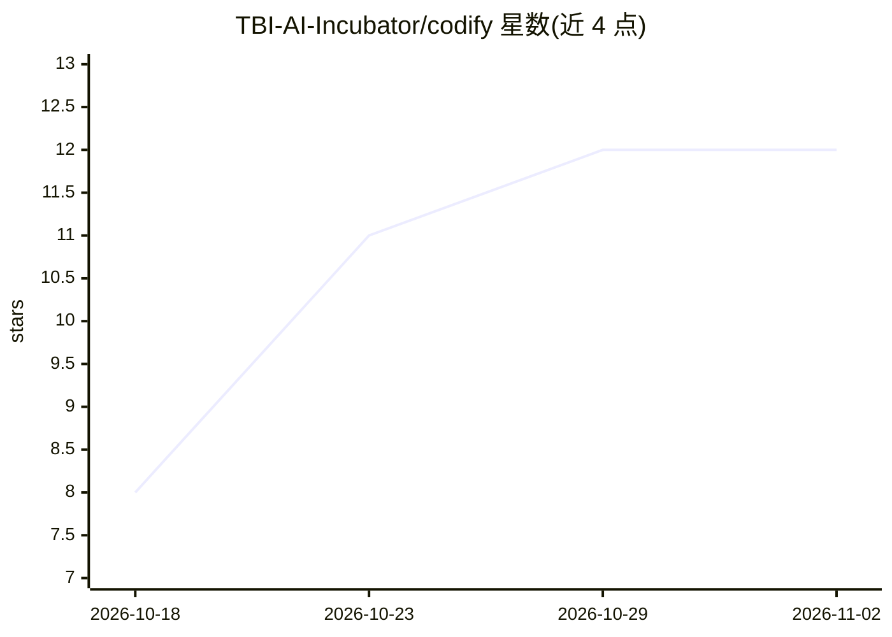

# TBI-AI-Incubator/codify

⭐ 12 · Python · Apache-2.0 · 推送 2026-10-30 · [GitHub](https://github.com/TBI-AI-Incubator/codify) · [官网](https://codify.centreai.global) · 组织维护

**将法律文本转换为 Akoma Ntoso 结构化 XML 的文档处理工具**

Codify Core 接收 PDF、文本与已有 Akoma Ntoso XML，经 OCR/转录与锚点驱动的结构化处理，生成可检索、可比较的结构化法律文档，输出包含提取文本、覆盖统计与校验结果。提供 Python 库、CLI、本地 Web 应用、REST API 与 MCP 服务器五种接口。基于规则的锚点检测无需模型调用，条款文本填充需配置 OpenAI 兼容端点（示例用 Gemini）。存储与搜索依赖 PostgreSQL（pgvector/pg_textsearch），本地服务无内置鉴权，输出未逐次对完整 OASIS schema 校验，需人工复核。

## 筛选速览

| 维度 | 判定 | 备注 |
|---|---|---|
| AI 角色 | `ai-ecosystem` | LLM/agent 周边工具 |
| 许可风险 | `permissive` | Apache-2.0 |
| 部署形态 | `self-host` | docker 或自建部署 |
| 模型依赖 | — | README 未给出锁定关系 |
| 硬件要求 | — | 无带数字的原话,不猜 |
| 安装摩擦 | `low` | 无编译、无系统依赖或容器化 |
| 成熟度 | — | 结构信号不足 |

## 能力要点

- 锚点驱动的结构检测，文本类文件可无模型调用离线扫描
- 输出 Akoma Ntoso 3.0 XML 及校验发现、覆盖统计与来源保留
- Python/CLI/Web 应用/REST/MCP 五种使用接口
- 按辖区配置规则定义文档结构与编号模式

## 适用场景

- 把成文法 PDF 转成结构化 Akoma Ntoso XML 供程序使用
- 按条款检索法律条文并与另一文档比较
- 为 agent 提供已存储法律条文的 MCP 访问

## 场景标签

`文档解析` `OCR` · 领域:知识与检索

## 证据(README 行号)

> L9: Codify Core converts legal documents into structured data that you can inspect,
> L22: Use Codify Core through Python, the command line, a local web app, REST or MCP.

## 星数曲线

2026-10-18 8 → 2026-11-02 12（+4）

---
*卡片 v1 · prompt 1.4 · 生成 2026-11-01 · 置信度 high · 依据 README sha `1e1956650fe9` · [字段定义](../../DATASET.md)*
