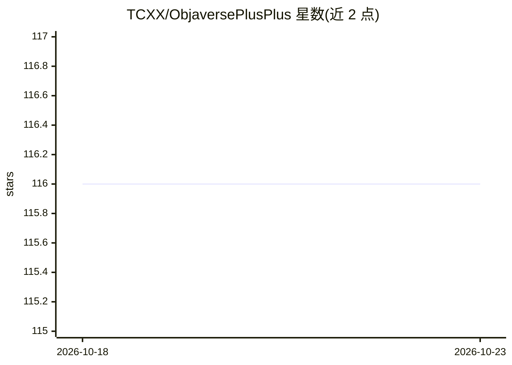

# TCXX/ObjaversePlusPlus

⭐ 116 · Python · NOASSERTION · 推送 2025-12-04 · [GitHub](https://github.com/TCXX/ObjaversePlusPlus) · [官网](https://huggingface.co/datasets/cindyxl/ObjaversePlusPlus) · 组织维护

**带质量标注的精选 3D 物体数据集，供筛选训练数据**

对 Objaverse 数据集做人工清洗与标注的研究数据集：人工标注 10,000 个 3D 物体的质量与特征属性，训练神经网络为其余约 79 万条数据生成质量分、二元特征（透明/场景/单色等）、实验性艺术风格与多边形密度标签。作者用 image-to-3D 生成任务（基于 OpenLRM）验证：约 5 万高质量子集相比 10 万随机子集取得更好的生成效果与更快的收敛。数据集在 Hugging Face 提供查看与下载，采用 ODC-By v1.0 许可；艺术风格与密度数据为实验性，未包含在论文中。

## 筛选速览

| 维度 | 判定 | 备注 |
|---|---|---|
| AI 角色 | `ai-knowledge` | 知识聚合/清单类 |
| 许可风险 | `none` | NOASSERTION |
| 部署形态 | `None` |  |
| 模型依赖 | — | README 未给出锁定关系 |
| 硬件要求 | — | 无带数字的原话,不猜 |
| 安装摩擦 | `low` | 无编译、无系统依赖或容器化 |
| 成熟度 | `idea` | |

## 能力要点

- 人工标注 10,000 个 3D 物体，模型标注扩展至约 79 万条 Objaverse 数据
- 四级质量分 + 五项二元特征标注体系
- 实验性艺术风格（7 类）与多边形密度标签
- image-to-3D 实验显示精选子集在生成质量与收敛速度上均有优势

## 适用场景

- 为 text-to-3D / image-to-3D 训练筛选高质量 3D 数据
- 按质量分、艺术风格、多边形密度等条件过滤 3D 训练数据
- 研究数据策展对生成任务效果的影响

## 场景标签

 · 领域:计算机视觉/3D 数据集

## 证据(README 行号)

> L17: We cleaned the Objaverse dataset so you don't have to. In this work, we meticulously curated a collection of Objave
> L26: 3. Annotated the Objaverse (~790k data) with quality and characteristic tags.
> L65: We set up an image-to-3D generation task to evaluate our dataset using OpenLRM. We compared:

## 星数曲线

2026-10-18 116 → 2026-10-23 116（+0）

---
*卡片 v1 · prompt 1.4 · 生成 2026-10-23 · 置信度 high · 依据 README sha `4ddba4890718` · [字段定义](../../DATASET.md)*
