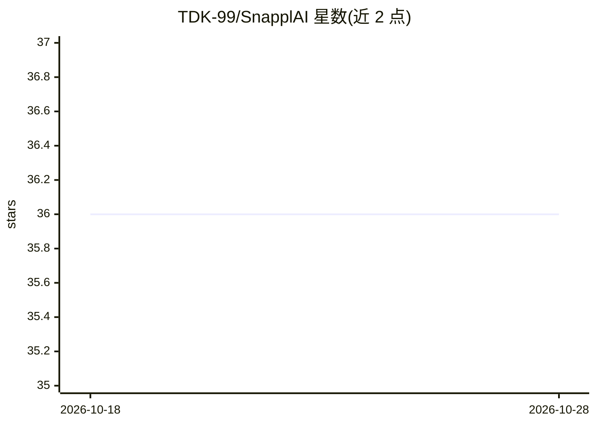

# TDK-99/SnapplAI

⭐ 36 · Python · NOASSERTION · 推送 2026-09-30 · [GitHub](https://github.com/TDK-99/SnapplAI) · 个人维护

**AI 自动筛选 LinkedIn 职位并按 CV 匹配打分，邮件推送最优岗位**

面向求职者的自动化流水线：按用户配置定时抓取 LinkedIn 新职位（python-jobspy），调用 Gemini 提取结构化字段并对照用户 PDF 简历逐条打分，将高分职位连同申请链接、Excel 附件和分析报告通过 SMTP 发送到邮箱。LLM 调用带指数退避重试与固定模型回退链（gemini-3.5-flash-lite → gemini-3.1-flash-lite）。无数据库，全程在单个 pandas DataFrame 内存流转。支持本地、Docker 与 GitHub Actions 定时部署，需自备 Google AI Studio API key 与邮箱应用密码。

## 筛选速览

| 维度 | 判定 | 备注 |
|---|---|---|
| AI 角色 | `ai-native` | 本体是模型或模型工具 |
| 许可风险 | `none` | NOASSERTION |
| 部署形态 | `self-host` | docker 或自建部署 |
| 模型依赖 | — | README 未给出锁定关系 |
| 硬件要求 | — | 无带数字的原话,不猜 |
| 安装摩擦 | `low` | 无编译、无系统依赖或容器化 |
| 成熟度 | — | 结构信号不足 |

## 能力要点

- 四步流水线：抓取→Gemini 结构化摘要→CV 匹配打分→SMTP 邮件投递
- chain-of-thought 约束：模型先写 analysis 再写 score
- LLM 调用带指数退避重试与固定模型回退链
- 支持本地运行、Docker 与 GitHub Actions 定时调度三种部署方式

## 适用场景

- 定时获取与简历匹配的 LinkedIn 新职位邮件提醒
- 用 AI 批量摘要和打分，筛掉不相关职位
- 通过 GitHub Actions 免服务器定时跑职位监控

## 场景标签

`网页抓取` `工作流自动化` · 领域:效率与自动化

## 证据(README 行号)

> L29: **2. Summarize** → `agentic_summarize()` sends each job description to Gemini, which extracts structured fields (ti
> L31: **3. Analyze** → `agentic_analyze()` reads your CV and scores each listing on how well it matches your profile. Cha

## 星数曲线

2026-10-18 36 → 2026-10-28 36（+0）

---
*卡片 v1 · prompt 1.4 · 生成 2026-10-25 · 置信度 mid · 依据 README sha `d40b283a5342` · [字段定义](../../DATASET.md)*
