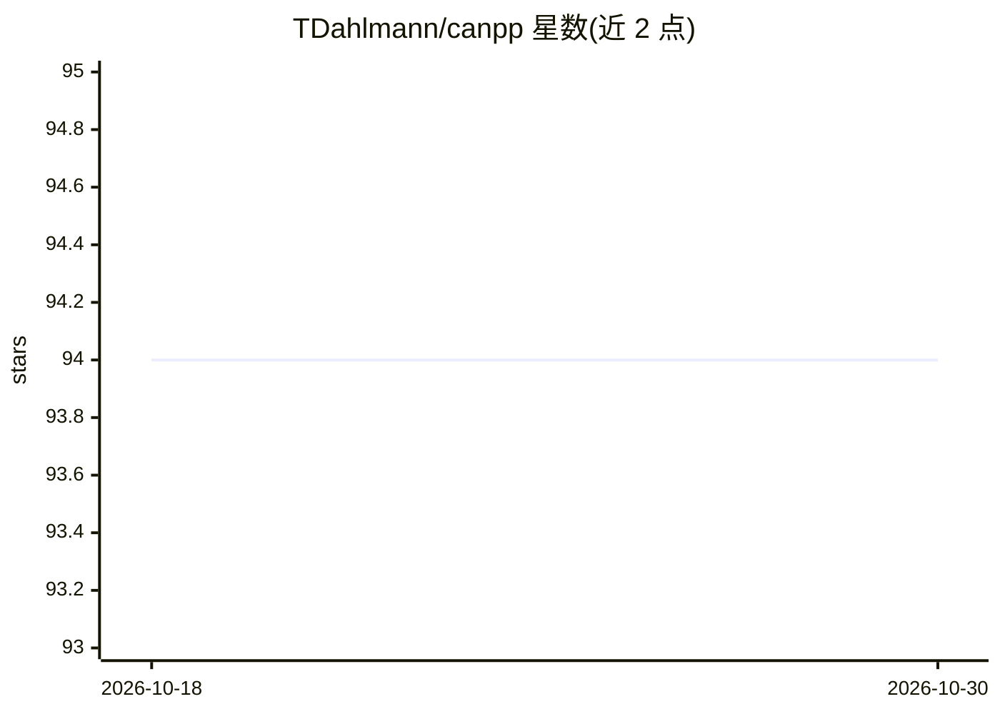

# TDahlmann/canpp

⭐ 94 · C · MIT · 推送 2026-09-18 · [GitHub](https://github.com/TDahlmann/canpp) · 个人维护

**Windows 下的 CAN 总线分析、收发与仿真 GUI 工具**

面向 Windows 用户的免费 CAN 总线工具：接收、发送并分析 CAN Classic 与 CAN FD 报文（*.asc/*.blf），支持 SuperCAN 固件设备、经 TCP/IP 连接的 CAN 硬件（含 SocketCan 示例实现）以及无硬件的虚拟总线。可导入 DBC/ARXML 数据库以符号形式显示信号并绘制波形，支持 C++ 编程仿真（内置编译器与 IDE）、报文跟踪回放、诊断（PDX 导入、故障内存等）与统计。程序免安装直接运行。注意：本产品与 AI 无关。

## 筛选速览

| 维度 | 判定 | 备注 |
|---|---|---|
| AI 角色 | `ai-enhanced` | 去掉 AI 部分产品仍成立 |
| 许可风险 | `permissive` | MIT |
| 部署形态 | `None` |  |
| 模型依赖 | — | README 未给出锁定关系 |
| 硬件要求 | — | 无带数字的原话,不猜 |
| 安装摩擦 | `low` | 无编译、无系统依赖或容器化 |
| 成熟度 | `idea` | |

## 能力要点

- CAN Classic 与 CAN FD 报文收发与分析（*.asc/*.blf）
- 导入 DBC/ARXML 后以符号形式显示信号并绘制波形
- C++ 编程 CAN 仿真，内置编译器与 IDE，无需安装
- 经 TCP/IP 连接 Linux 设备上的 SocketCan 硬件（可多通道）

## 适用场景

- 汽车电子开发中抓取并解析 CAN/CAN FD 总线报文
- 无硬件情况下用 C++ 编写 ECU 行为做总线仿真
- 通过树莓派等 Linux 设备远程接入 CAN 硬件进行测试
- 导入 PDX 做诊断，读取故障内存与测量数据

## 场景标签

 · 领域:汽车电子/嵌入式工具

## 证据(README 行号)

> L4: CAN++ is a free Windows program for receiving, transmitting and analyzing (*.asc, *.blf) CAN bus messages (CAN Class
> L9: - **CAN simulation** is possible by programming CAN behaviour in C++.

## 星数曲线

2026-10-18 94 → 2026-10-30 94（+0）

---
*卡片 v1 · prompt 1.4 · 生成 2026-10-23 · 置信度 low · 依据 README sha `e11392187666` · [字段定义](../../DATASET.md)*
