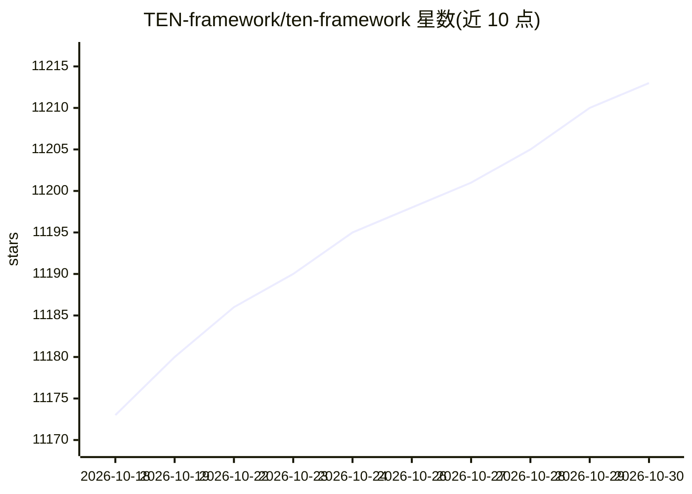

# TEN-framework/ten-framework

⭐ 11,213 · Python · NOASSERTION · 推送 2026-10-28 · [GitHub](https://github.com/TEN-framework/ten-framework) · [官网](https://agent.theten.ai/) · 组织维护 · 中文 README

**构建实时多模态对话语音 AI agent 的开源框架**

TEN 是用于实时多模态对话 AI 的开源框架，面向构建语音/视频 agent 的开发者。提供扩展机制（STT/LLM/TTS/VAD/轮次检测等）与 TMAN Designer 可视化编辑器；附带多个 Agent 示例：语音助手、涂鸦画板、说话人分离、口型同步虚拟形象、SIP 电话、转写工具及 ESP32-S3 硬件集成。本地运行依赖 Docker 与 Node.js v18，需配置 Agora、OpenAI、Deepgram、ElevenLabs 的密钥；最低要求 2 核 CPU、4GB 内存。支持 Docker 镜像发布及 Vercel/Netlify 前端分体部署。许可以为 Apache 2.0 附加限制条款。

## 筛选速览

| 维度 | 判定 | 备注 |
|---|---|---|
| AI 角色 | `ai-ecosystem` | LLM/agent 周边工具 |
| 许可风险 | `none` | NOASSERTION |
| 部署形态 | `self-host` | docker 或自建部署 |
| 模型依赖 | — | README 未给出锁定关系 |
| 硬件要求 | — | 无带数字的原话,不猜 |
| 安装摩擦 | `low` | 无编译、无系统依赖或容器化 |
| 成熟度 | — | 结构信号不足 |

## 能力要点

- 实时多模态对话框架，含 STT/LLM/TTS 扩展与 TMAN Designer 可视化编辑
- 多类 Agent 示例：语音助手、说话人分离、口型同步形象、SIP 电话、转写
- 支持 ESP32-S3 Korvo V3 开发板运行 agent 示例
- Docker Compose 开发容器与 Docker 镜像发布，支持 Vercel/Netlify 前端分体部署

## 适用场景

- 开发低延迟实时语音助手并接入 RTC/WebSocket
- 构建带说话人分离或口型同步虚拟形象的对话应用
- 将语音 agent 部署到 ESP32 等嵌入式硬件
- 自托管 agent 服务并分体部署前后端

## 场景标签

`Agent 框架` · 领域:Agent 开发

## 证据(README 行号)

> L47: TEN is an open-source framework for real-time multimodal conversational AI.
> L62:  Multi-Purpose Voice Assistant — This low-latency, high-quality real-time assistant supports both RTC and [WebSocke

## 星数曲线

2026-10-18 11,173 → 2026-10-30 11,213（+40）

---
*卡片 v1 · prompt 1.4 · 生成 2026-10-20 · 置信度 mid · 依据 README sha `9225df78625f` · [字段定义](../../DATASET.md)*
