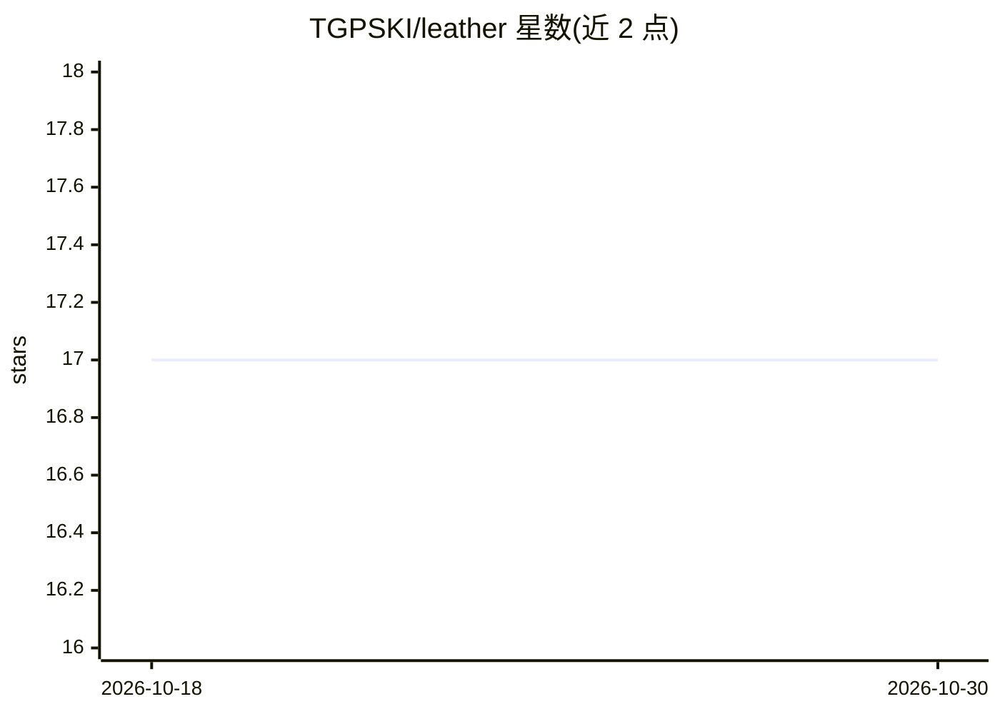

# TGPSKI/leather

⭐ 17 · Go · GPL-3.0 · 推送 2026-10-23 · [GitHub](https://github.com/TGPSKI/leather) · [官网](https://leather.sh) · 个人维护

**单二进制 Go 本地 agent 运行时：声明式定义、调度与编排**

仅用 Go 标准库编译的单二进制 agent 基础设施：以 Markdown front matter 定义 agent（系统提示+多轮对话），通过 YAML lifecycle 定义定时任务、一次性运行与 webhook 触发；提供队列（文件系统 FIFO）、多阶段路由（curing）、worker、流水线编排、MCP 服务器支持与 shell-mcp（把 shell 命令转为工具），并带 Stdlib-JS 开发者界面与 Telegram/Signal 通知。模型侧通过 OpenAI Chat Completions 兼容 API 接入本地或云端端点。面向自托管/树莓派等本地优先场景，从源码或 go install 安装，v0.5.4。

## 筛选速览

| 维度 | 判定 | 备注 |
|---|---|---|
| AI 角色 | `ai-ecosystem` | LLM/agent 周边工具 |
| 许可风险 | `viral` | GPL-3.0 |
| 部署形态 | `library` | 以包/库形式分发 |
| 模型依赖 | — | README 未给出锁定关系 |
| 硬件要求 | — | 无带数字的原话,不猜 |
| 安装摩擦 | `medium` | 含编译或系统依赖之一 |
| 成熟度 | — | 结构信号不足 |

## 能力要点

- stdlib-only 单二进制，无 Python 栈、无托管控制面、无 broker
- Markdown 声明 agent + YAML 调度（cron/webhook/一次性运行）
- 队列、多 agent 路由、fan-in/fan-out 流水线与 MCP 支持
- OpenAI 兼容端点，可接本地 11434 端口或云端 API

## 适用场景

- 在工作站或树莓派上运行定时/事件驱动的 LLM agent
- 把 shell 命令封装为 agent 工具，串联多 agent 流水线
- homelab 自托管自动化任务，无需外部控制面

## 场景标签

`Agent 框架` `多智能体` `工作流自动化` · 领域:Agent 开发

## 证据(README 行号)

> L5: **Local agent infrastructure in one stdlib-only Go binary.**
> L66: |**Tools**|Skills, toolsets, MCP server support, and `shell-mcp` (`make build-shell-mcp`) for turning shell command

## 星数曲线

2026-10-18 17 → 2026-10-30 17（+0）

---
*卡片 v1 · prompt 1.4 · 生成 2026-10-29 · 置信度 high · 依据 README sha `4c88b340f20c` · [字段定义](../../DATASET.md)*
