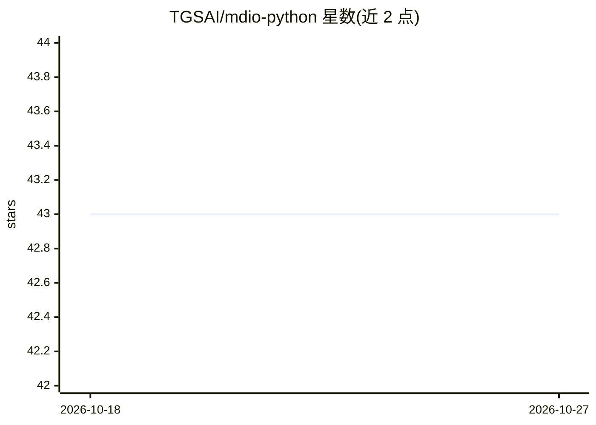

# TGSAI/mdio-python

⭐ 43 · Python · Apache-2.0 · 推送 2026-10-24 · [GitHub](https://github.com/TGSAI/mdio-python) · [官网](https://mdio.dev/) · 组织维护

**面向多维能源数据的云原生分块存储引擎（Python 库）**

MDIO 是处理大型多维能源数据集的 Python 库，服务于资源评估、机器学习和数据处理工作流。基于 Zarr 与 fsspec 提供云原生分块存储，支持 Blosc/ZFP 有损与无损压缩模型，通过 Dask 实现分布式读写；油气领域支持 SEG-Y 格式 2D-5D 地震数据的导入导出、按 MDIO 模板优化分块，并提供 Xarray 数据模型接口与基于 Click 的 CLI。以 pip/conda 安装，v1 已发布但文档仍在更新，官方声明非 TGS 正式产品。

## 筛选速览

| 维度 | 判定 | 备注 |
|---|---|---|
| AI 角色 | `ai-enhanced` | 去掉 AI 部分产品仍成立 |
| 许可风险 | `permissive` | Apache-2.0 |
| 部署形态 | `library` | 以包/库形式分发 |
| 模型依赖 | — | README 未给出锁定关系 |
| 硬件要求 | — | 无带数字的原话,不猜 |
| 安装摩擦 | `low` | 无编译、无系统依赖或容器化 |
| 成熟度 | `idea` | |

## 能力要点

- 基于 Zarr/fsspec 的云原生分块存储
- Dask 分布式读写与 Blosc/ZFP 压缩
- SEG-Y 2D-5D 地震数据导入导出与模板化分块
- Xarray 数据模型接口与 Click CLI

## 适用场景

- 将大型 SEG-Y 地震数据转为分块云存储格式
- 在资源评估与机器学习流程中读取多维时序数据
- 对多维能源数据做分布式并行读写与压缩存储

## 场景标签

 · 领域:能源/地球物理数据基础设施

## 证据(README 行号)

> L32: **_"MDIO"_** is a library to work with large multidimensional energy datasets.
> L34: time series data in a format that makes it easier to use in resource assessment,
> L48: - Distributed reads and writes using [Dask][dask].

## 星数曲线

2026-10-18 43 → 2026-10-27 43（+0）

---
*卡片 v1 · prompt 1.4 · 生成 2026-10-25 · 置信度 high · 依据 README sha `12e9d0ef673e` · [字段定义](../../DATASET.md)*
