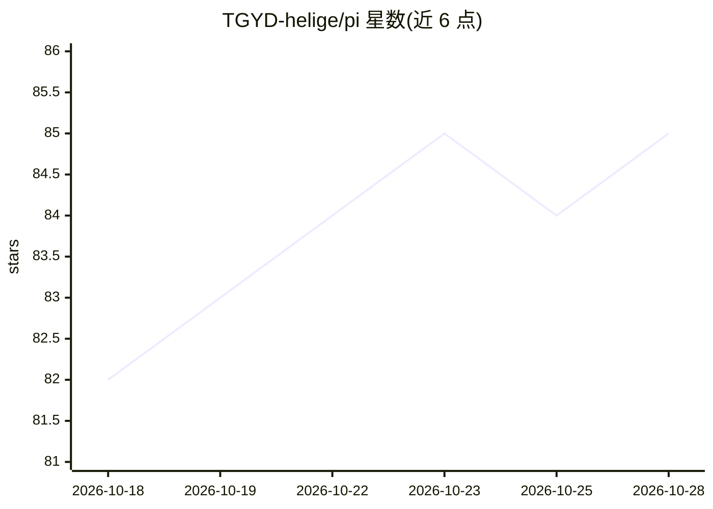

# TGYD-helige/pi

⭐ 85 · TypeScript · Apache-2.0 · 推送 2026-10-27 · [GitHub](https://github.com/TGYD-helige/pi) · 组织维护 · 中文 README

**Pi AI-agent 运行时的插件化 TypeScript 扩展包集合**

为 Pi Agent 及相关应用提供运行时契约、适配器与编排辅助的共享 npm 包仓库：核心包（pi-shared/pi-storage）定义类型与 JSON/MySQL-Prisma 持久化；扩展包通过 ./extension 入口按需加载，覆盖 Lark/钉钉/企微工作台集成、浏览器与桌面自动化、持久记忆（MEMORY.md+Mem0）、遥测（Langfuse/OpenTelemetry）、定时任务、图像与视频生成、安全策略等。宿主应用自行负责 HTTP 路由、认证与模型运行时。ESM-only，Node.js>=24，pnpm 构建，Apache-2.0 许可。

## 筛选速览

| 维度 | 判定 | 备注 |
|---|---|---|
| AI 角色 | `ai-ecosystem` | LLM/agent 周边工具 |
| 许可风险 | `permissive` | Apache-2.0 |
| 部署形态 | `library` | 以包/库形式分发 |
| 模型依赖 | — | README 未给出锁定关系 |
| 硬件要求 | — | 无带数字的原话,不猜 |
| 安装摩擦 | `medium` | 含编译或系统依赖之一 |
| 成熟度 | — | 结构信号不足 |

## 能力要点

- 约 18 个可组合扩展包，均通过 ./extension 入口注册到 Pi 运行时
- IM 工作台集成覆盖 Lark/飞书、钉钉、企微（日历、文档、消息、待办等）
- pi-storage 提供 JSON 文件与 MySQL/Prisma 两种持久化适配器
- 视频生成扩展内置 FFmpeg 运行时并支持 Remotion 可编辑合成

## 适用场景

- 为 Pi 运行时宿主应用按需集成记忆、遥测、浏览器自动化等能力
- 让 agent 接入飞书/钉钉/企微完成日程、文档、消息操作
- 为 agent 应用添加带 QC 与断点恢复的批量视频生成

## 场景标签

`浏览器自动化` `GUI 自动化` `LLM 可观测性` `视频生成` · 领域:效率与自动化

## 证据(README 行号)

> L7: On Pi 0.99+, video, teamwork, curated memory, Mem0, and scheduler tools expose bounded structured results for codemo
> L9: This repository contains the open-source runtime contracts, adapters, and orchestration helpers that are consumed by

## 星数曲线

2026-10-18 82 → 2026-10-28 85（+3）

---
*卡片 v1 · prompt 1.4 · 生成 2026-10-24 · 置信度 high · 依据 README sha `2d8adda18e0f` · [字段定义](../../DATASET.md)*
