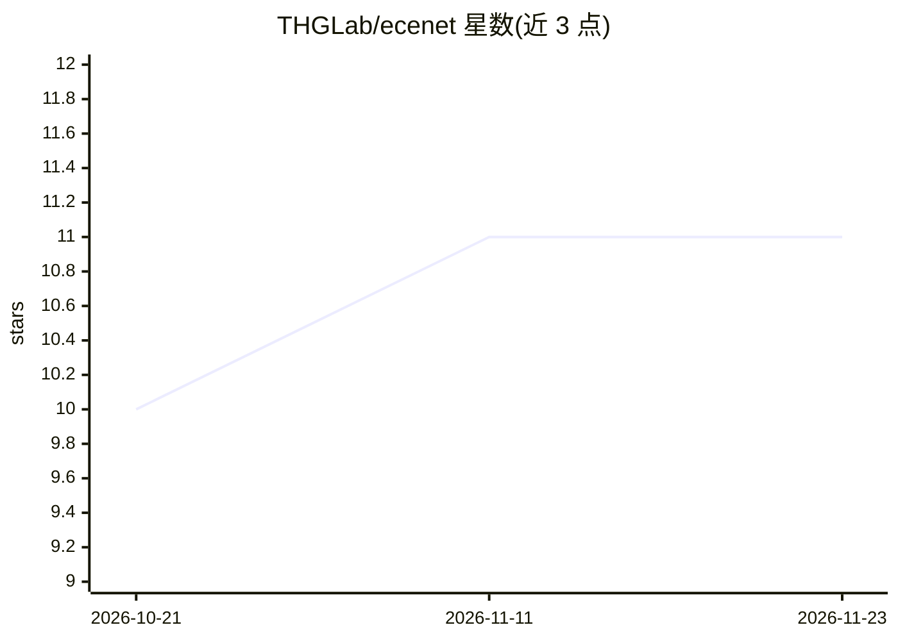

# THGLab/ecenet

⭐ 11 · Python · NOASSERTION · 推送 2026-09-10 · [GitHub](https://github.com/THGLab/ecenet) · 组织维护

**面向计算化学/材料研究者的 SO(3)-等变机器学习原子间势**

ECENet 是一个用逐边 SO(2)-等变特征并通过节点传递 SO(3)-等变消息的机器学习原子间势（MLIP），基于 PyTorch 实现。提供能量/力/应力的 autograd 计算，并带 ASE calculator 支持分子动力学与结构弛豫。训练器为 import-and-call 形式，支持 rMD17、MD22、SPICE、MPTrj 数据集训练及 torchrun 多 GPU DDP；可选 LES（Latent Ewald Summation）扩展长程静电，可选 Triton 融合内核加速。论文预印本尚在准备中。纯 PyTorch 实现，无需编译自定义 CUDA 扩展。

## 筛选速览

| 维度 | 判定 | 备注 |
|---|---|---|
| AI 角色 | `ai-native` | 本体是模型或模型工具 |
| 许可风险 | `none` | NOASSERTION |
| 部署形态 | `library` | 以包/库形式分发 |
| 模型依赖 | — | README 未给出锁定关系 |
| 硬件要求 | — | 无带数字的原话,不猜 |
| 安装摩擦 | `medium` | 含编译或系统依赖之一 |
| 成熟度 | — | 结构信号不足 |

## 能力要点

- 逐边 SO(2)-等变特征的消息传递架构
- 能量/力/应力 autograd 输出，ASE calculator 支持与弛豫
- 可选 LES 长程静电扩展（潜电荷/偶极/Born 有效电荷输出）
- torchrun 多 GPU DDP 训练与可选 Triton 融合内核

## 适用场景

- 训练分子/材料体系的机器学习势并跑分子动力学
- 对周期性体系做含长程静电的能量/力/应力评估
- 输出潜电荷、偶极与 Born 有效电荷轨迹

## 场景标签

`科研工具` · 领域:学习与行业

## 证据(README 行号)

> L3: **ECENet** is an SO(3)-equivariant interatomic potential (MLIP). It uses
> L8: - Energy / forces / stress via autograd; ASE calculator for MD and relaxations.
> L36: ECENet is pure PyTorch — no compiled/custom CUDA extensions to build. The

## 星数曲线

2026-10-21 10 → 2026-11-23 11（+1）

---
*卡片 v1 · prompt 1.4 · 生成 2026-11-18 · 置信度 high · 依据 README sha `20ff00ae0d56` · [字段定义](../../DATASET.md)*
