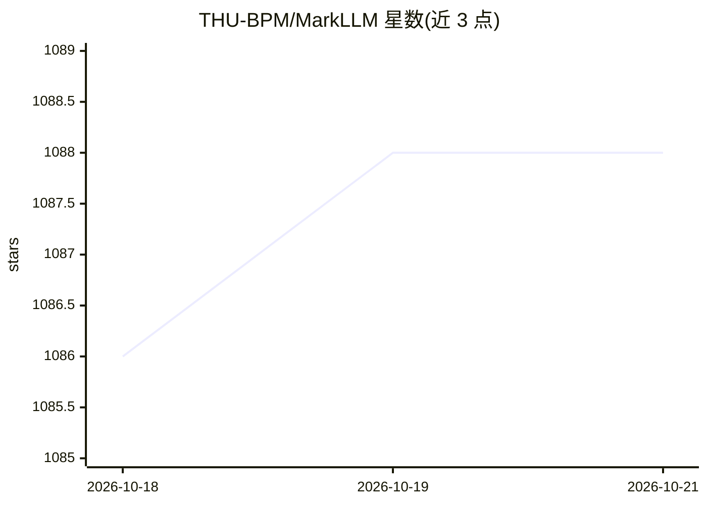

# THU-BPM/MarkLLM

⭐ — · [GitHub]() · 组织维护

**LLM 水印算法研究与评估开源工具包**

面向 LLM 文本水印研究的开源工具包：提供统一可扩展框架，实现 20 余种水印算法（KGW、Unigram、SynthID-Text、SemStamp 等，多来自 ICML/ICLR/ACL 论文），并内置 12 种评估工具覆盖可检测性、鲁棒性与文本质量影响，支持自定义自动化评估流水线与算法机制可视化。以 pip 包与源码两种方式提供，部分自训练模型需先从 Hugging Face 仓库下载权重；EXPEdit/ITSEdit 算法需额外编译 Cython 扩展。论文入选 EMNLP 2024 Demo。

## 筛选速览

| 维度 | 判定 | 备注 |
|---|---|---|
| AI 角色 | `ai-ecosystem` | LLM/agent 周边工具 |
| 许可风险 | `permissive` | — |
| 部署形态 | `library` | 以包/库形式分发 |
| 模型依赖 | — | README 未给出锁定关系 |
| 硬件要求 | — | 无带数字的原话,不猜 |
| 安装摩擦 | `medium` | 含编译或系统依赖之一 |
| 成熟度 | — | 结构信号不足 |

## 能力要点

- 统一框架实现 20 余种 LLM 水印算法（KGW/Unigram/SIR/SynthID-Text 等）
- 12 种评估工具：可检测性、鲁棒性、文本质量分析
- 自动化评估流水线与算法机制可视化工具
- pip install markllm 发布为 Python 包

## 适用场景

-  researchers 对比不同 LLM 水印算法的可检测性与鲁棒性
- 在自己的代码中调用现成水印算法生成与检测水印
- 评估攻击（改写、同义替换）下水印的存活情况

## 场景标签

`模型评测` `科研工具` · 领域:评测与运维

## 证据(README 行号)

> L103: MarkLLM is an open-source toolkit developed to facilitate the research and application of watermarking technologie
> L109: - **Implementation Framework:** MarkLLM provides a unified and extensible platform for the implementation of vario

## 星数曲线

2026-10-18 1,086 → 2026-10-21 1,088（+2）

---
*卡片 v1 · prompt 1.4 · 生成 2026-10-21 · 置信度 high · 依据 README sha `eaea10bf7919` · [字段定义](../../DATASET.md)*
