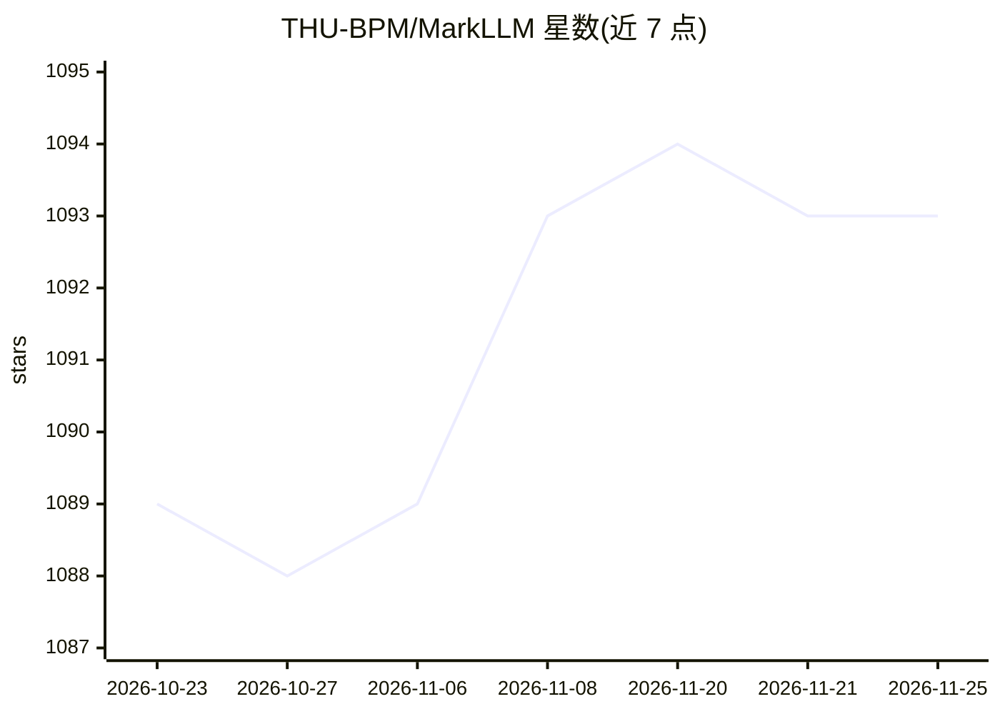

# THU-BPM/MarkLLM

⭐ 1,093 · Python · Apache-2.0 · 推送 2026-11-23 · [GitHub](https://github.com/THU-BPM/MarkLLM) · [官网](https://aclanthology.org/2024.emnlp-demo.7/) · 组织维护 · 中文 README

**面向 LLM 水印研究者与社区的开源水印工具包**

MarkLLM 是一个促进 LLM 水印技术研究的开源工具包，覆盖水印算法的统一实现框架、算法机制可视化与评估三大模块。实现框架目前支持多算法家族的十余种水印算法（KGW、Unigram、SWEET、UPV、SynthID-Text 等）；评估模块提供 12 个工具，覆盖可检测性、鲁棒性与文本质量影响，并配有检测与文本质量评估流水线。面向研究者与更广泛的社区，接受社区贡献新算法；使用自训练模型的算法需先从 Hugging Face 仓库下载权重放入 model/ 目录。

## 筛选速览

| 维度 | 判定 | 备注 |
|---|---|---|
| AI 角色 | `ai-ecosystem` | LLM/agent 周边工具 |
| 许可风险 | `permissive` | Apache-2.0 |
| 部署形态 | `library` | 以包/库形式分发 |
| 模型依赖 | local-ok | 支持本地模型 |
| 硬件要求 | — | 无带数字的原话,不猜 |
| 安装摩擦 | `medium` | 含编译或系统依赖之一 |
| 成熟度 | — | 结构信号不足 |

## 能力要点

- 统一可扩展的水印算法实现框架，支持 KGW、Unigram、SWEET、SynthID-Text 等多种算法
- 12 个评估工具覆盖可检测性、鲁棒性与文本质量影响，含可定制的自动评估流水线
- 提供算法机制的可视化工具
- 可通过 pip install markllm 作为 Python 包安装

## 适用场景

- 研究并复现 LLM 文本水印算法
- 评估水印的可检测性与抗攻击鲁棒性
- 可视化理解不同水印算法的机制
- 为机器生成文本的溯源研究搭建实验环境

## 场景标签

`模型评测` `科研工具` · 领域:评测与运维

## 证据(README 行号)

> L103: MarkLLM is an open-source toolkit developed to facilitate the research and application of watermarking technologie
> L109: - **Implementation Framework:** MarkLLM provides a unified and extensible platform for the implementation of vario

## 星数曲线

2026-10-23 1,089 → 2026-11-25 1,093（+4）

---
*卡片 v1 · prompt 1.4 · 生成 2026-11-25 · 置信度 high · 依据 README sha `91fe39384d23` · [字段定义](../../DATASET.md)*
