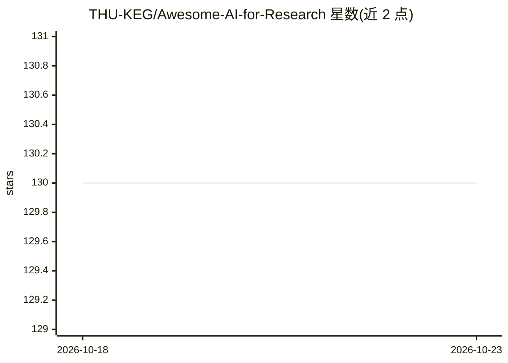

# THU-KEG/Awesome-AI-for-Research

⭐ 130 · Python · NOASSERTION · 推送 2026-08-24 · [GitHub](https://github.com/THU-KEG/Awesome-AI-for-Research) · 组织维护 · 中文 README

**AI for Research 论文与系统策展清单：按研究阶段/角色/领域组织**

由 THU-KEG 维护的 AI 驱动科研（AI4Research）资源聚合清单：收录 100 条条目（含 19 个 benchmark），聚焦参与、优化或重塑研究流程的近期系统。条目可按研究阶段（发现、构思、规划、实验、写作评审等 7 阶段）、研究循环中的角色（L1 工具/L2 协作者/L3 系统）、应用领域（AI、生物医学、化学、数学等 9 类）及证据强度导航；条目以源数据维护，通过 python3 tooling/build.py 生成 Markdown 页面，采用 CC BY 4.0 许可。

## 筛选速览

| 维度 | 判定 | 备注 |
|---|---|---|
| AI 角色 | `ai-knowledge` | 知识聚合/清单类 |
| 许可风险 | `none` | NOASSERTION |
| 部署形态 | `None` |  |
| 模型依赖 | — | README 未给出锁定关系 |
| 硬件要求 | — | 无带数字的原话,不猜 |
| 安装摩擦 | `low` | 无编译、无系统依赖或容器化 |
| 成熟度 | — | 结构信号不足 |

## 能力要点

- 100 条条目、19 个 benchmark，声明 curated 与 benchmark-aware 编目口径
- L1-L3 人机角色阶梯区分工具、协作者与 AI 驱动系统
- 按 7 个研究阶段、9 个应用领域多视图导航
- 条目维护源数据，用 build.py 重新生成 Markdown 页面

## 适用场景

- 查找端到端 AI 科研系统与相关 benchmark
- 按学科领域定位垂直方向的 AI4Research 系统
- 比较自进化/实验改进类系统与通用 agent 方法

## 场景标签

`科研工具` `精选清单` · 领域:学习与行业

## 证据(README 行号)

> L3: Awesome license: CC BY 4.0 entries: 100 benchmarks: 19 updated: 2026-08-24 curation: curated coverage: benchmark-awa
> L10: > This repository focuses on recent, high-signal work on AI-driven research itself: systems that participate in the
> L63: |Section|Focus|Count|

## 星数曲线

2026-10-18 130 → 2026-10-23 130（+0）

---
*卡片 v1 · prompt 1.4 · 生成 2026-10-23 · 置信度 high · 依据 README sha `8f6742fd5e6e` · [字段定义](../../DATASET.md)*
