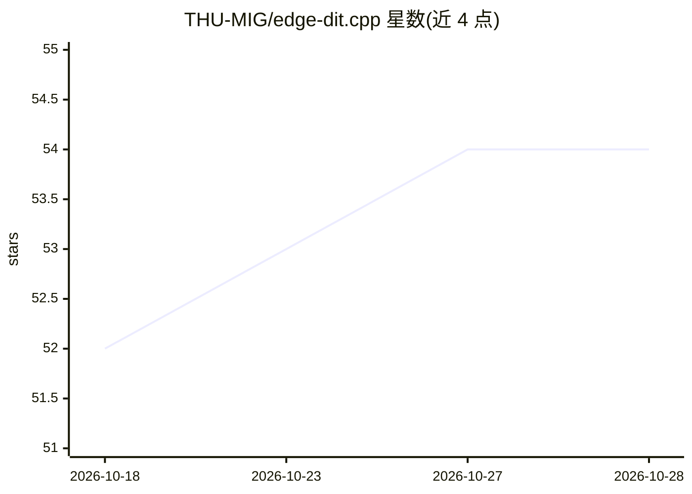

# THU-MIG/edge-dit.cpp

⭐ 54 · C++ · Apache-2.0 · 推送 2026-09-01 · [GitHub](https://github.com/THU-MIG/edge-dit.cpp) · [官网](https://thu-mig.github.io/edge-dit.cpp/) · 组织维护 · 中文 README

**面向本地/边缘设备的 DiT 推理引擎，运行图像与视频生成模型**

基于 ggml 的纯 C/C++ Diffusion Transformer 推理引擎，运行时不依赖 Python/PyTorch。支持 FLUX.1/FLUX.2 klein、SD3/3.5、Qwen-Image、Wan 2.1、MiniMax-H3 等模型家族，覆盖文生图、图像编辑与视频（含音频）生成，后端含 CUDA/CPU/Vulkan/Metal。关键机制：--auto-fit 自动选择量化档与组件放置、分层与按组件 offload 使 20GB+ 模型可在 24GB 显存运行、ed-convert 离线量化为 GGUF。提供 CLI、C API、HTTP server 与 Python 绑定；当前处于 v0.1.0-alpha 公开预览，API/CLI 尚未稳定。源码克隆编译安装。

## 筛选速览

| 维度 | 判定 | 备注 |
|---|---|---|
| AI 角色 | `ai-ecosystem` | LLM/agent 周边工具 |
| 许可风险 | `permissive` | Apache-2.0 |
| 部署形态 | `None` |  |
| 模型依赖 | — | README 未给出锁定关系 |
| 硬件要求 | — | 无带数字的原话,不猜 |
| 安装摩擦 | `medium` | 含编译或系统依赖之一 |
| 成熟度 | `idea` | |

## 能力要点

- 纯 C/C++ 运行时（基于 ggml），无 Python/PyTorch 依赖
- 单一运行时统一文生图、图像编辑与视频生成，支持 FLUX/SD3/Qwen-Image/Wan/MiniMax-H3
- --auto-fit 与分层/按组件 offload 使大模型适配有限显存
- ed-convert 离线量化为可移植 GGUF（含 imatrix 校准）

## 适用场景

- 在 24GB 消费级显卡上本地运行 FLUX/Qwen-Image 等大型 DiT 模型
- 通过 C API 或 HTTP server 将 DiT 推理嵌入本地应用
- 离线预量化模型权重以加速部署加载

## 场景标签

`图像生成` `视频生成` `推理引擎` `模型量化` · 领域:内容生成

## 证据(README 行号)

> L12: **edge-dit.cpp** is an open-source, DiT-first C/C++ inference engine for efficient
> L13: **Diffusion Transformer (DiT)** inference. Built on **ggml**, it provides a unified
> L14: runtime for image generation, image editing, and video generation across local,

## 星数曲线

2026-10-18 52 → 2026-10-28 54（+2）

---
*卡片 v1 · prompt 1.4 · 生成 2026-10-24 · 置信度 high · 依据 README sha `ebba728077e4` · [字段定义](../../DATASET.md)*
