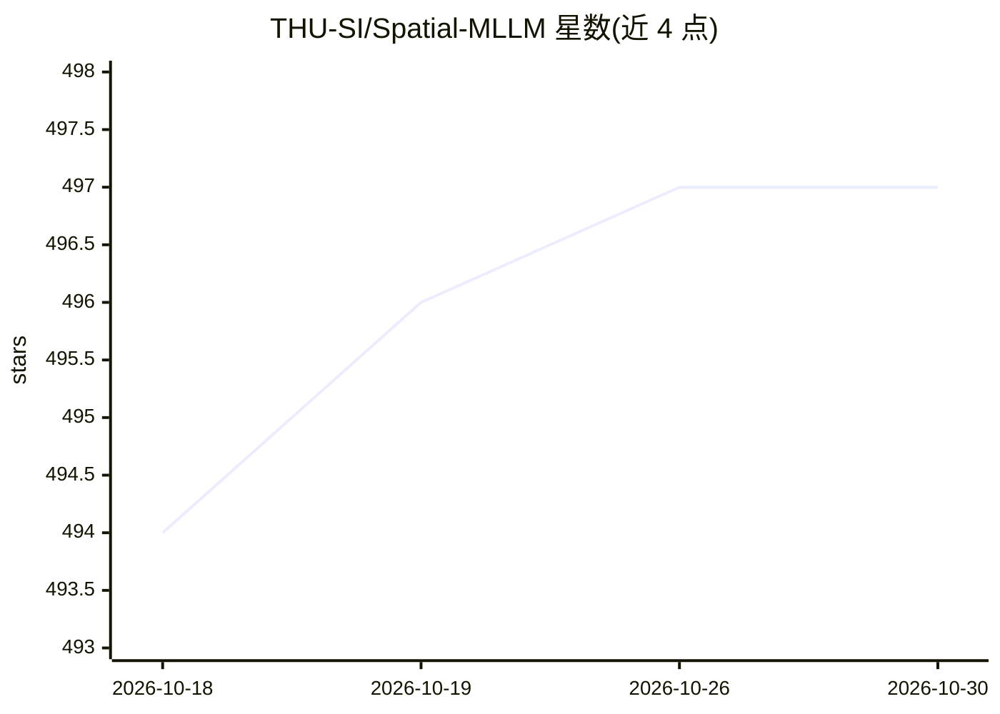

# THU-SI/Spatial-MLLM

⭐ 497 · Python · MIT · 推送 2026-02-05 · [GitHub](https://github.com/THU-SI/Spatial-MLLM) · [官网](https://diankun-wu.github.io/Spatial-MLLM/) · 组织维护 · 中文 README

**视频多模态大模型：提升视觉空间理解与推理能力**

清华大学团队发表于 NeurIPS 2025（Spotlight）的研究成果官方实现：Spatial-MLLM 在视频 MLLM 基础上加入由视觉几何基础模型初始化的空间编码器与 2D 视觉编码器，推理阶段采用空间感知帧采样策略选取信息量高的帧。提供 v1.1 版 SFT 模型（135K/820K）、精化训练代码、VSI-Bench 与 ScanQA 评测脚本及空间感知采样脚本。环境需 conda、PyTorch 2.6.0 + CUDA 12.4 与 Flash Attention 2 预编译 wheel。

## 筛选速览

| 维度 | 判定 | 备注 |
|---|---|---|
| AI 角色 | `ai-native` | 本体是模型或模型工具 |
| 许可风险 | `permissive` | MIT |
| 部署形态 | `library` | 以包/库形式分发 |
| 模型依赖 | — | README 未给出锁定关系 |
| 硬件要求 | — | 无带数字的原话,不猜 |
| 安装摩擦 | `medium` | 含编译或系统依赖之一 |
| 成熟度 | — | 结构信号不足 |

## 能力要点

- 2D 视觉编码器 + 空间编码器（视觉几何基础模型初始化）+ LLM 骨干的结构
- 空间感知帧采样策略应对 GPU 显存受限的输入帧数限制
- 发布 v1.1-Instruct-135K 与 820K 两个 SFT 模型及精化训练代码
- 提供 VSI-Bench 与 ScanQA 评测脚本与空间感知采样脚本

## 适用场景

- 对视频输入做房间物体计数等视觉空间推理问答
- 在 VSI-Bench / ScanQA 基准上复现或对比空间推理评测结果
- 基于提供的 SFT 训练代码做空间智能模型的继续训练研究

## 场景标签

`多模态` `模型评测` `微调` · 领域:评测与运维

## 证据(README 行号)

> L20:  Spatial-MLLM: We propose Spatial-MLLM, a method that significantly enhances the visual-based spatial intelligence 
> L32: Overview of Spatial-MLLM. Our model is composed of a 2D visual encoder, a spatial encoder which is initialized from

## 星数曲线

2026-10-18 494 → 2026-10-30 497（+3）

---
*卡片 v1 · prompt 1.4 · 生成 2026-10-23 · 置信度 mid · 依据 README sha `6a3eb4e4e1b8` · [字段定义](../../DATASET.md)*
