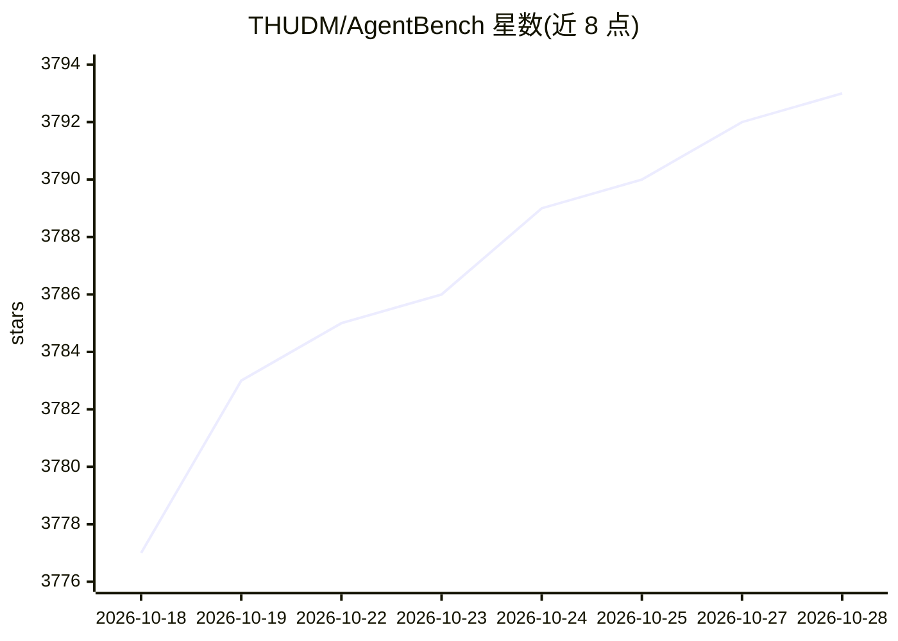

# THUDM/AgentBench

⭐ 3,793 · Python · Apache-2.0 · 推送 2026-02-08 · [GitHub](https://github.com/THUDM/AgentBench) · 组织维护 · 中文 README

**评测 LLM 作为 Agent 能力的多环境基准（ICLR'24）**

THUDM 维护的 LLM-as-Agent 评测基准，含 8 个交互环境（OS、数据库、知识图谱、卡牌游戏、横向思维谜题、ALFWorld、WebShop、Mind2Web），每个数据集提供 Dev/Test 两个切分。2025 年 10 月起仓库转为基于 AgentRL 的函数调用版本（AgentBench FC），对 5 个任务提供容器化部署，一条 Docker Compose 命令启动任务 worker、freebase 与 Redis 服务。安装需 Python 3.9（conda）+ pip 依赖 + Docker 镜像，通过配置 OpenAI API Key 等方式接入被测模型，另提供笔记本用的 lite 预设。旧版可通过 v0.1/v0.2 回退。

## 筛选速览

| 维度 | 判定 | 备注 |
|---|---|---|
| AI 角色 | `ai-ecosystem` | LLM/agent 周边工具 |
| 许可风险 | `permissive` | Apache-2.0 |
| 部署形态 | `self-host` | docker 或自建部署 |
| 模型依赖 | — | README 未给出锁定关系 |
| 硬件要求 | — | 无带数字的原话,不猜 |
| 安装摩擦 | `low` | 无编译、无系统依赖或容器化 |
| 成熟度 | — | 结构信号不足 |

## 能力要点

- 8 个交互环境评测 LLM 作为自主 Agent 的能力（Dev/Test 双切分）
- 新版基于 AgentRL，函数调用式提示与全容器化部署
- Docker Compose 一键启动 5 个任务 worker 及 freebase/Redis 服务
- 提供低资源 lite 预设（每任务 1 worker）

## 适用场景

- 在多环境中系统评测 LLM 的 Agent 能力并对比排行榜
- 复现或扩展 LLM Agent 评测任务（含扩展指南）
- 为 RL 训练提供多任务多轮交互环境（AgentRL 集成）

## 场景标签

`模型评测` `强化学习` · 领域:评测与运维

## 证据(README 行号)

> L86: **AgentBench** is the first benchmark designed to evaluate **LLM-as-Agent** across a diverse spectrum of different
> L9: The current repository contains the function-calling version of AgentBench, integrated with AgentRL, an end-to-end m

## 星数曲线

2026-10-18 3,777 → 2026-10-28 3,793（+16）

---
*卡片 v1 · prompt 1.4 · 生成 2026-10-21 · 置信度 high · 依据 README sha `7019eb6febc9` · [字段定义](../../DATASET.md)*
