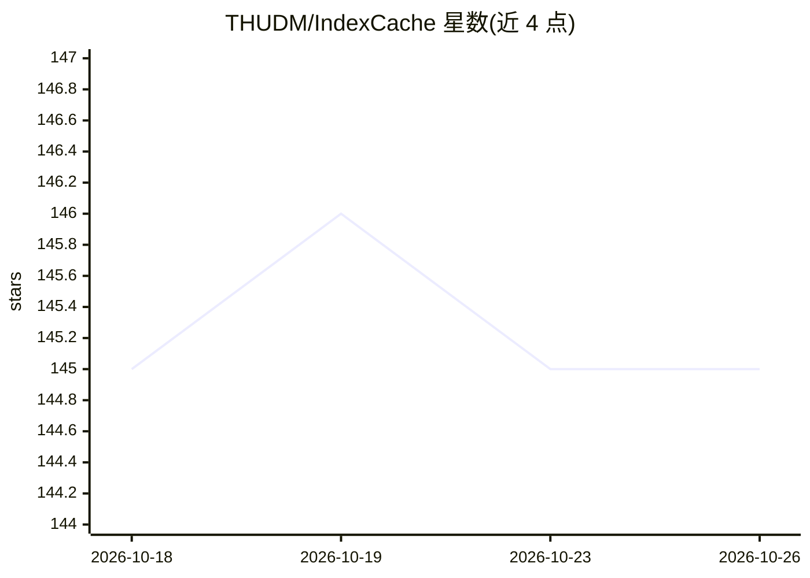

# THUDM/IndexCache

⭐ 145 · NOASSERTION · 推送 2026-03-14 · [GitHub](https://github.com/THUDM/IndexCache) · [官网](https://huggingface.co/papers/2603.12201) · 组织维护 · 中文 README

**给推理引擎的补丁：跨层复用稀疏注意力索引以加速 DSA 推理**

面向 SGLang 与 vLLM 的 patch，为使用 DeepSeek Sparse Attention（DSA）的模型（DeepSeek-V3.2、GLM-5）启用 IndexCache 加速：将层划分为保留 indexer 的 Full 层与复用缓存索引的 Shared 层，消除最多 75% 的 indexer 计算，README 报告 30B 模型 200K 上下文下 1.82× prefill、1.48× decode 加速。提供 training-free（贪心搜索删减）与 training-aware（多层蒸馏）两种方式，通过 --json-model-override-args / --hf-overrides 配置启动，零额外 GPU 显存。

## 筛选速览

| 维度 | 判定 | 备注 |
|---|---|---|
| AI 角色 | `ai-ecosystem` | LLM/agent 周边工具 |
| 许可风险 | `none` | NOASSERTION |
| 部署形态 | `None` |  |
| 模型依赖 | local-ok | 支持本地模型 |
| 硬件要求 | — | 无带数字的原话,不猜 |
| 安装摩擦 | `low` | 无编译、无系统依赖或容器化 |
| 成熟度 | — | 结构信号不足 |

## 能力要点

- SGLang/vLLM patch 形式，跨层复用 top-k 索引，最多移除 75% indexer 计算
- 30B 模型 200K 上下文 1.82× prefill、1.48× decode 加速
- training-free 贪心搜索与 training-aware 多层蒸馏两种方案
- 支持 DeepSeek-V3.2 与 GLM-5，零额外 GPU 显存

## 适用场景

- 长上下文 DSA 模型部署时降低 prefill/decode 延迟
- 在不重训模型的前提下削减 indexer 计算开销
- GLM-5 生产环境推理加速验证

## 场景标签

`推理引擎` · 领域:训练与推理

## 证据(README 行号)

> L12: This repository provides a patch for SGLang and vLLM that enables **IndexCache** inference acceleration for models 
> L61: git clone https://github.com/sgl-project/sglang.git

## 星数曲线

2026-10-18 145 → 2026-10-26 145（+0）

---
*卡片 v1 · prompt 1.4 · 生成 2026-10-23 · 置信度 high · 依据 README sha `6b467066b968` · [字段定义](../../DATASET.md)*
