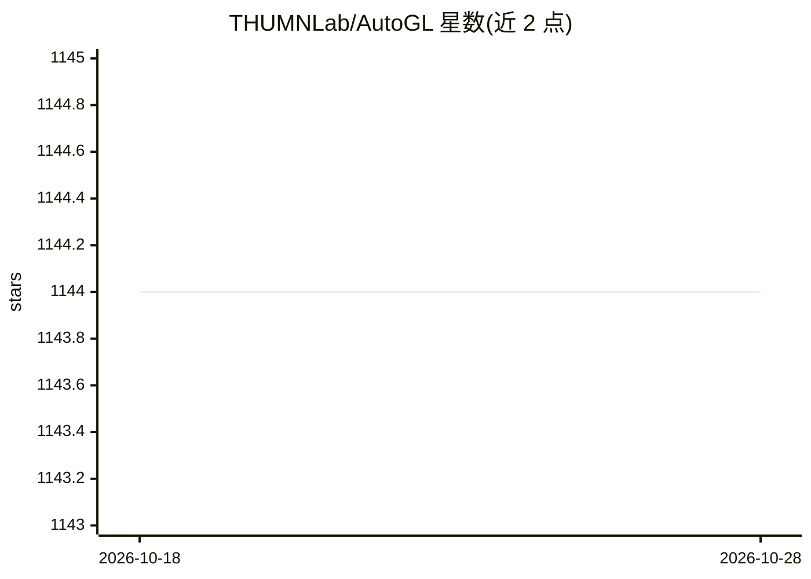

# THUMNLab/AutoGL

⭐ 1,144 · Python · Apache-2.0 · 推送 2025-11-20 · [GitHub](https://github.com/THUMNLab/AutoGL) · [官网](http://mn.cs.tsinghua.edu.cn/AutoGL/) · 组织维护

**面向图机器学习的 autoML 框架与工具包**

由清华 THUMNLab 开发的图自动机器学习框架：用 datasets 模块维护基于 PyG 或 DGL 的图数据集，通过 auto solver 调度特征工程、神经架构搜索（NAS）、自动模型、超参优化与自动集成五个模块，自动求解节点分类、链接预测、图分类等图任务；支持同质/异质任务、鲁棒性算法与图自监督学习，v0.4 起提供轻量版 AutoGL-light 供自定义流水线。面向研究者和开发者，同时可作为实现与测试自研模型的框架，需 Python≥3.6、PyTorch≥1.6 及 PyG 或 DGL 后端。

## 筛选速览

| 维度 | 判定 | 备注 |
|---|---|---|
| AI 角色 | `ai-ecosystem` | LLM/agent 周边工具 |
| 许可风险 | `permissive` | Apache-2.0 |
| 部署形态 | `library` | 以包/库形式分发 |
| 模型依赖 | — | README 未给出锁定关系 |
| 硬件要求 | — | 无带数字的原话,不猜 |
| 安装摩擦 | `low` | 无编译、无系统依赖或容器化 |
| 成熟度 | — | 结构信号不足 |

## 能力要点

- 五模块自动求解：特征工程/NAS/自动模型/HPO/自动集成
- 支持 PyG 与 DGL 双后端，兼容异质节点分类
- 提供多种 NAS 算法（RL、进化、GASSO、AutoAttend 等）与 HPO 算法
- v0.4.1 起附带轻量版 AutoGL-light 支持自定义流水线

## 适用场景

- 在图数据集上自动完成从特征到模型选择的完整 autoML 流程
- 实现和测试自定义的图机器学习或 autoML 模型
- 配合 NAS-Bench-Graph 加速 GraphNAS 算法的性能估计

## 场景标签

 · 领域:图机器学习/AutoML

## 证据(README 行号)

> L31: AutoGL is developed for researchers and developers to conduct autoML on graph datasets and tasks easily and quickly
> L37: Different graph-based machine learning tasks are handled by different `AutoGL solvers`, which make use of five main

## 星数曲线

2026-10-18 1,144 → 2026-10-28 1,144（+0）

---
*卡片 v1 · prompt 1.4 · 生成 2026-10-21 · 置信度 high · 依据 README sha `433edbedc85a` · [字段定义](../../DATASET.md)*
