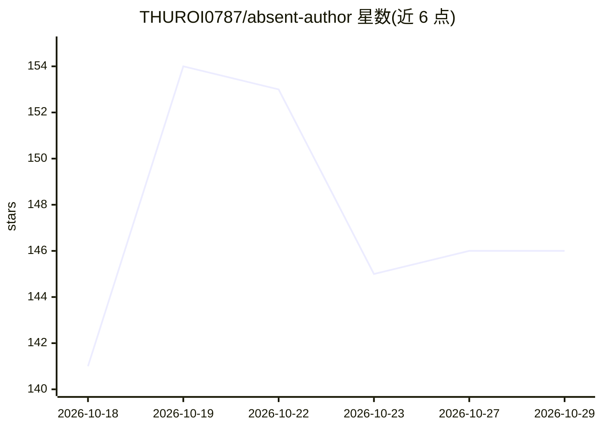

# THUROI0787/absent-author

⭐ 146 · Python · MIT · 推送 2026-10-07 · [GitHub](https://github.com/THUROI0787/absent-author) · [官网](https://thuroi0787.github.io/absent-author/) · 组织维护 · 中文 README

**论文作者缺席检测工具集：证据清单+两个 agent 技能**

面向审稿人、作者与评审规范维护者的 AI 代笔论文识别工具集：包含 83 条带来源的证据条目（分四层，附强度与误报说明）、两个供 Claude Code / Codex 等 agent 读取的 SKILL.md 技能（投稿前作者自查、审稿分诊出 W/R/Q 等级与象限），以及一个无依赖的 Python lint 脚本，统计 28 种表层痕迹并给出校准后的命中参考。工具输出候选线索供人工判断，明确声明不是 AI 检测器、语言证据不用于定罪。

## 筛选速览

| 维度 | 判定 | 备注 |
|---|---|---|
| AI 角色 | `ai-ecosystem` | LLM/agent 周边工具 |
| 许可风险 | `permissive` | MIT |
| 部署形态 | `library` | 以包/库形式分发 |
| 模型依赖 | — | README 未给出锁定关系 |
| 硬件要求 | — | 无带数字的原话,不猜 |
| 安装摩擦 | `low` | 无编译、无系统依赖或容器化 |
| 成熟度 | — | 结构信号不足 |

## 能力要点

- 83 条带来源与强度标注的证据条目，四层结构（语言/研究/产物/在场作者）
- paper-author-pass 与 paper-slop-screen 两个 agent 技能，供 Claude Code / Codex 使用
- slop_lint.py 校准统计 28 种表层痕迹（Python 3.9+，无依赖），附参考核验、数字台账等辅助脚本
- 明确边界声明：不给 AI 概率，语言证据仅计入写作轴，干净报告不能证明任何事

## 适用场景

- 审稿人对可疑投稿做分诊筛查并生成可引用的缺陷清单
- 作者投稿前自查 AI 痕迹、核验参考文献与数字一致性
- 会议/期刊维护者引用证据清单制定审稿规范

## 场景标签

`科研工具` · 领域:学习与行业

## 证据(README 行号)

> L3:  An evidence list and two agent skills for spotting research papers that AI produced and no human stood behind.
> L7:  Skills for Claude Code and Codex
> L32: Then, in Claude Code, Codex or any agent that reads `SKILL.md`:

## 星数曲线

2026-10-18 141 → 2026-10-29 146（+5）

---
*卡片 v1 · prompt 1.4 · 生成 2026-10-22 · 置信度 mid · 依据 README sha `6e9dc7cda0f6` · [字段定义](../../DATASET.md)*
