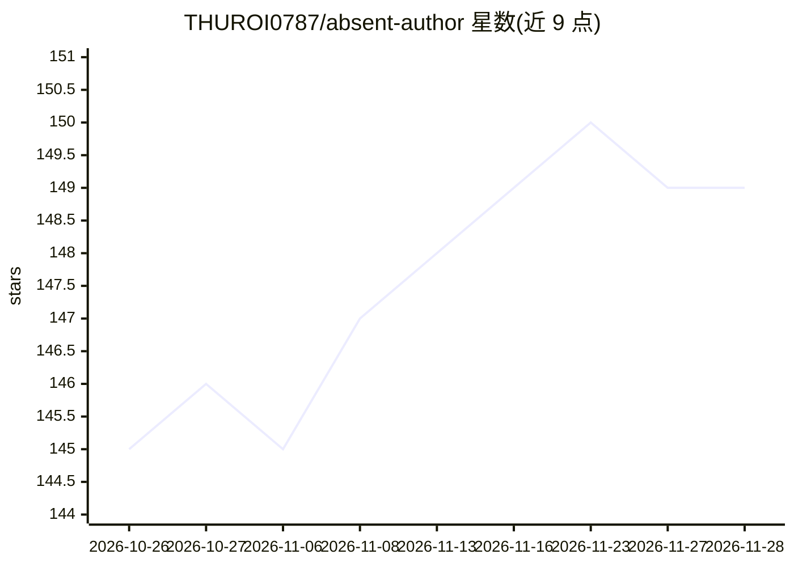

# THUROI0787/absent-author

⭐ 149 · Python · MIT · 推送 2026-11-04 · [GitHub](https://github.com/THUROI0787/absent-author) · [官网](https://thuroi0787.github.io/absent-author/) · 组织维护 · 中文 README

**给作者与审稿人用的 AI 代写论文识别证据库与 agent 技能**

仓库包含 83 条带来源的证据条目、两个 agent 技能和四个 Python 工具：paper-author-pass 面向作者自查（提问、声明-证据映射、参考文献与数字核验），paper-slop-screen 面向审稿人给出 W/R/Q 评级与四象限定位，slop_lint.py 独立运行于 Python 3.9+ 无额外依赖，另有参考文献核验、数字一致性、PDF 隐藏文本三个辅助脚本。所有工具只输出候选供人阅读，不做最终判定；技能通过 install.sh 安装到 Claude Code/Codex 等读取 SKILL.md 的 agent。

## 筛选速览

| 维度 | 判定 | 备注 |
|---|---|---|
| AI 角色 | `ai-native` | 本体是模型或模型工具 |
| 许可风险 | `permissive` | MIT |
| 部署形态 | `library` | 以包/库形式分发 |
| 模型依赖 | — | README 未给出锁定关系 |
| 硬件要求 | — | 无带数字的原话,不猜 |
| 安装摩擦 | `low` | 无编译、无系统依赖或容器化 |
| 成熟度 | — | 结构信号不足 |

## 能力要点

- 83 条带来源与误报说明的证据条目，分四层组织
- 两个技能：作者提交前自查与审稿人 W/R/Q 分级筛查
- 28 项表面痕迹的校准 lint，Python 3.9+ 无依赖可独立运行
- 辅助工具核验参考文献、数字漂移与 PDF 隐藏文本

## 适用场景

- 投稿前自查论文是否存在无人把关的 AI 生成痕迹
- 审稿或 AC 分诊可疑投稿并生成可引用的证据段落
- 审稿规范维护者参考证据条目与豁免规则

## 场景标签

`科研工具` · 领域:学习与行业

## 证据(README 行号)

> L3:  An evidence list and two agent skills for spotting research papers that AI produced and no human stood behind.
> L29: |anyone who wants a **quick surface scan**|`tools/slop_lint.py`|calibrated counts of 28 surface traces, as candidat
> L39: Then, in Claude Code, Codex or any agent that reads `SKILL.md`:

## 星数曲线

2026-10-26 145 → 2026-11-28 149（+4）

---
*卡片 v1 · prompt 1.4 · 生成 2026-11-27 · 置信度 mid · 依据 README sha `249f4aeb3358` · [字段定义](../../DATASET.md)*
