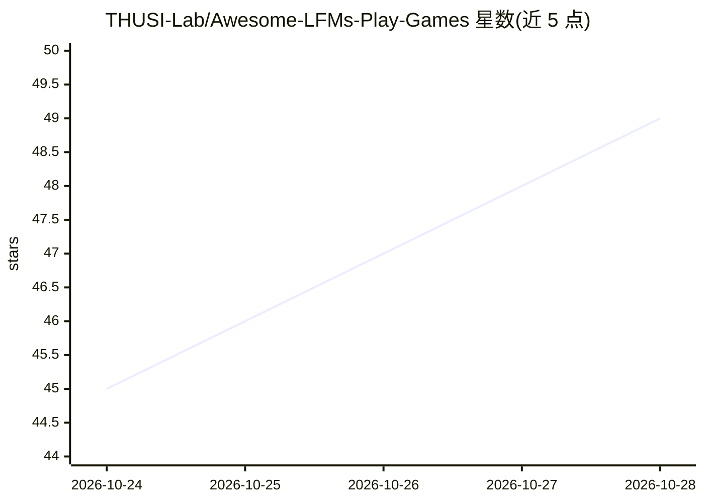

# THUSI-Lab/Awesome-LFMs-Play-Games

⭐ 49 · Python · 推送 2026-10-27 · [GitHub](https://github.com/THUSI-Lab/Awesome-LFMs-Play-Games) · [官网](https://thusi-lab.github.io/Awesome-LFMs-Play-Games/) · 组织维护 · 中文 README

**基础模型玩游戏综述的论文清单：数据集/模型/框架/基准四类资源**

清华大学等机构研究者维护的 survey 配套论文清单，主题为大型基础模型作为游戏玩家。收录 210 个去重资源（257 条分类记录），按 Dataset、Model、Harness、Benchmark 四大支柱组织，条目含日期、关键词、论文/项目/代码链接；主要收录 2025 年以后工作，另含 2026 年 10 月新增的 32 条及来源与发布状态记录。配套论文预印本（arXiv 2605.09965）、项目网页与视频概述。清单本身不含可安装或运行的软件。

## 筛选速览

| 维度 | 判定 | 备注 |
|---|---|---|
| AI 角色 | `ai-knowledge` | 知识聚合/清单类 |
| 许可风险 | `none` | — |
| 部署形态 | `None` |  |
| 模型依赖 | — | README 未给出锁定关系 |
| 硬件要求 | — | 无带数字的原话,不猜 |
| 安装摩擦 | `low` | 无编译、无系统依赖或容器化 |
| 成熟度 | — | 结构信号不足 |

## 能力要点

- 210 个去重资源，按数据集/模型/框架/基准四支柱组织
- 条目记录日期、关键词、论文/项目/代码链接与发布状态
- 含 2026 年 10 月新增 32 条的独立目录与溯源记录
- 配套 survey 论文、项目网页与视频概述

## 适用场景

- 查找游戏智能体与世界模型方向的最新论文和代码
- 按数据集/模型/框架/基准分类浏览研究资源
- 了解基础模型玩游戏领域的研究脉络与更新动态

## 场景标签

`精选清单` · 领域:学习与行业

## 证据(README 行号)

> L13:  210 unique resources
> L34: How does one player become more capable across a wider range of games? This survey follows the experience it learns
> L59: **210 unique resources · 257 category records · 32 additions since the April 2026 cutoff**

## 星数曲线

2026-10-24 45 → 2026-10-28 49（+4）

---
*卡片 v1 · prompt 1.4 · 生成 2026-10-25 · 置信度 high · 依据 README sha `acce9881dc07` · [字段定义](../../DATASET.md)*
