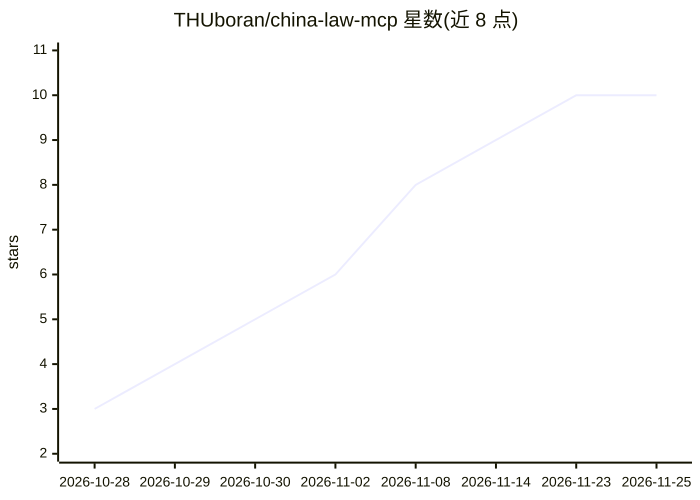

# THUboran/china-law-mcp

⭐ 10 · Python · MIT · 推送 2026-11-03 · [GitHub](https://github.com/THUboran/china-law-mcp) · [官网](https://pypi.org/project/china-law-mcp/) · 组织维护 · 中文 README

**给 AI 提供中国法条检索与引用核验的 MCP 服务器**

以 MCP 服务器（stdio）形式运行的本地中国法律条文检索与引用核验工具：内置 378 部法律、23,995 条现行条文（SQLite 15 MB 随仓库提供），提供自然语言法条检索、条号直查、单条引用核验与批量文本引用抽取核验共 5 个工具。检索为纯本地 BM25（rank-bm25 + jieba），不调用外部 API。可通过 uvx/pip/Docker/源码安装，支持 Claude Code/Desktop、Cursor、VS Code 等客户端接入，另提供免 MCP 的 Agent Skill 版零依赖 CLI。覆盖范围不含行政法规与司法解释，不构成法律意见。

## 筛选速览

| 维度 | 判定 | 备注 |
|---|---|---|
| AI 角色 | `ai-knowledge` | 知识聚合/清单类 |
| 许可风险 | `permissive` | MIT |
| 部署形态 | `self-host` | docker 或自建部署 |
| 模型依赖 | locked-api |  |
| 硬件要求 | — | 无带数字的原话,不猜 |
| 安装摩擦 | `low` | 无编译、无系统依赖或容器化 |
| 成熟度 | — | 结构信号不足 |

## 能力要点

- 378 部法律、23,995 条现行条文本地 SQLite 库，开箱即用
- verify_citation 与 check_citations_in_text 逐条核验引用、列出编造条目
- BM25 + 口语同义词扩展的本地自然语言检索，无网络依赖与调用成本
- 同能力提供 MCP 服务器与 Agent Skill 两种接入形态

## 适用场景

- 让 AI 助手回答法律问题时引用真实存在的条文
- 批量核验一段法律分析文本中的引用是否有据
- 命令行快速检索口语问题对应的法条原文

## 场景标签

`语义搜索` · 领域:知识与检索

## 证据(README 行号)

> L148: - **378 部法律、23,995 条现行条文**（宪法、法律、立法解释全量）
> L169: 检索是**纯本地 BM25**（`rank-bm25` + `jieba`），不调用任何外部 API，因此没有网络依赖、没有调用成本，也不会把你的查询发给第三方。

## 星数曲线

2026-10-28 3 → 2026-11-25 10（+7）

---
*卡片 v1 · prompt 1.4 · 生成 2026-11-23 · 置信度 high · 依据 README sha `bc9c38b4e512` · [字段定义](../../DATASET.md)*
