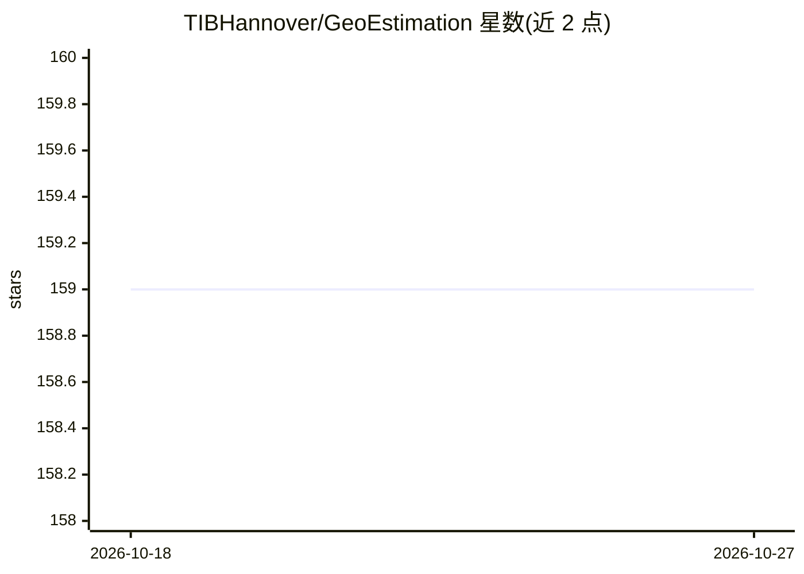

# TIBHannover/GeoEstimation

⭐ 159 · 推送 2026-01-19 · [GitHub](https://github.com/TIBHannover/GeoEstimation) · [官网](https://labs.tib.eu/geoestimation) · 组织维护

**照片地理位置估计论文的官方仓库（代码与模型已撤除）**

ECCV 2018 论文《Geolocation Estimation of Photos using a Hierarchical Model and Scene Classification》的官方 GitHub 页面，曾提供基于层次模型与场景分类的照片地理定位实现：TensorFlow 1.14（ResNet101）与 PyTorch（ResNet50）版本，含训练、推理、评测脚本及预训练权重下载。2025 年 12 月，维护方以图像地理定位技术的伦理与社会风险（隐私、监控、军事滥用风险）为由，从仓库及全部提交历史中删除源代码与模型权重，现仅保留文档与论文结果供透明记录，无可执行代码。

## 筛选速览

| 维度 | 判定 | 备注 |
|---|---|---|
| AI 角色 | `ai-native` | 本体是模型或模型工具 |
| 许可风险 | `none` | — |
| 部署形态 | `self-host` | docker 或自建部署 |
| 模型依赖 | — | README 未给出锁定关系 |
| 硬件要求 | — | 无带数字的原话,不猜 |
| 安装摩擦 | `low` | 无编译、无系统依赖或容器化 |
| 成熟度 | — | 结构信号不足 |

## 能力要点

- 论文官方实现（TensorFlow 与 PyTorch 两版，含预训练权重）
- 报告了 Im2GPS / Im2GPS3k 测试集上按半径的定位准确率
- 使用 S2 几何库进行地理单元格划分
- 2025 年 12 月因伦理风险撤除全部代码与模型权重

## 适用场景

- 查阅照片地理定位论文的方法与量化结果
- 了解该技术被撤回的原因与双用途风险讨论
- 复现论文历史的实验设置与数据集链接（代码已不可用）

## 场景标签

 · 领域:计算机视觉/地理定位

## 证据(README 行号)

> L13: The source code and trained models previously hosted in this repository have been **removed**.
> L35: **Status:** This repository is maintained for documentation purposes only.
> L45: **12th December 2020 - *PyTorch* version:**

## 星数曲线

2026-10-18 159 → 2026-10-27 159（+0）

---
*卡片 v1 · prompt 1.4 · 生成 2026-10-22 · 置信度 mid · 依据 README sha `f3b594c744a0` · [字段定义](../../DATASET.md)*
