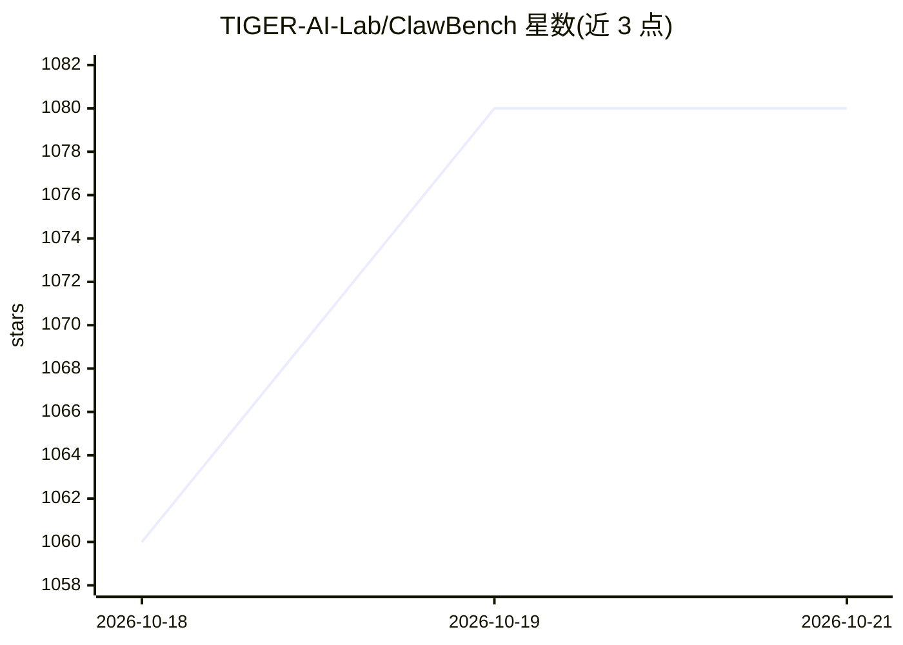

# TIGER-AI-Lab/ClawBench

⭐ 1,078 · Python · Apache-2.0 · 推送 2026-10-17 · [GitHub](https://github.com/TIGER-AI-Lab/ClawBench) · [官网](https://claw-bench.com) · 组织维护 · 中文 README

**评测浏览器 AI agent 日常在线任务的开源基准**

TIGER-AI-Lab/NAIL Group 维护的开源基准，在 163 个真实网站上评测 AI 浏览器 agent 完成订餐、订票、求职、邮件管理等日常任务的能力。V1 含 152 个任务、V2 含 129 个任务，覆盖 15 个生活类别。机制上在隔离 Docker 容器中启动 Chromium，由 agent 驱动浏览器，拦截器记录全部请求，输出五层证据（录像、请求、动作、消息、拦截数据）；评分采用两阶段：拦截匹配 + LLM 裁判。以 PyPI 包与源码两种方式运行，需要 Python 3.11+、uv 和 Docker/Podman；附带三个 Hugging Face 数据集与在线榜单。

## 筛选速览

| 维度 | 判定 | 备注 |
|---|---|---|
| AI 角色 | `ai-ecosystem` | LLM/agent 周边工具 |
| 许可风险 | `permissive` | Apache-2.0 |
| 部署形态 | `library` | 以包/库形式分发 |
| 模型依赖 | — | README 未给出锁定关系 |
| 硬件要求 | — | 无带数字的原话,不猜 |
| 安装摩擦 | `low` | 无编译、无系统依赖或容器化 |
| 成熟度 | — | 结构信号不足 |

## 能力要点

- 281 个任务、163 个真实网站、15 个生活类别的 V1/V2 语料
- 隔离容器 + Chromium + 请求拦截器的五层证据记录
- 两阶段评分：确定性拦截匹配 + LLM 裁判（默认 deepseek-v4-pro）
- 发布三个 Hugging Face 数据集（任务定义与完整执行 trace）

## 适用场景

- 我要给自家浏览器 agent 跑一个标准化评测并提交榜单
- 研究 agent 执行轨迹，做轨迹分析或训练数据
- 对比不同模型与 harness 在日常任务上的完成率

## 场景标签

`模型评测` · 领域:评测与运维

## 证据(README 行号)

> L70: **ClawBench is an open-source benchmark that evaluates AI browser agents on everyday online tasks — booking travel,
> L146:    You pick a task            ClawBench spins up           Agent drives the         Interceptor captures
> L257: **Intercepted** = final HTTP request matched the task's URL/method (Stage 1, deterministic). **Reward (lenient)** 

## 星数曲线

2026-10-18 1,060 → 2026-10-21 1,080（+20）

---
*卡片 v1 · prompt 1.4 · 生成 2026-10-21 · 置信度 high · 依据 README sha `0fe72a78f564` · [字段定义](../../DATASET.md)*
