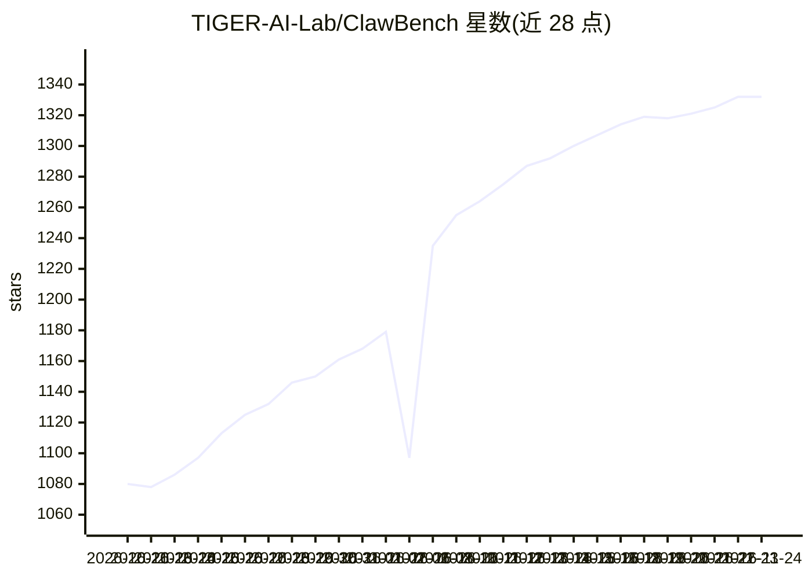

# TIGER-AI-Lab/ClawBench

⭐ 1,340 · Python · Apache-2.0 · 推送 2026-11-05 · [GitHub](https://github.com/TIGER-AI-Lab/ClawBench) · [官网](https://claw-bench.com) · 组织维护 · 中文 README

**评测浏览器 AI agent 完成日常在线任务的基准**

发表于 EMNLP 2026 Findings 的开源基准，覆盖 281 个任务、163 个真实网站、15 个生活类别（订旅行、点外卖、投简历、管邮件等）。机制上以 Docker/Podman 启动隔离容器运行 Chromium，由被测 agent 驱动浏览器，拦截 HTTP 请求并录制五层数据；默认采用拦截判定加 LLM judge 两阶段评分，也支持与人类参照轨迹的对比评估。提供 PyPI 安装包、TUI 与 CLI、三个 Hugging Face 数据集（任务定义与执行轨迹）及在线排行榜。运行需 Python 3.11+、uv 与 Docker/Podman 引擎。

## 筛选速览

| 维度 | 判定 | 备注 |
|---|---|---|
| AI 角色 | `ai-ecosystem` | LLM/agent 周边工具 |
| 许可风险 | `permissive` | Apache-2.0 |
| 部署形态 | `library` | 以包/库形式分发 |
| 模型依赖 | — | README 未给出锁定关系 |
| 硬件要求 | — | 无带数字的原话,不猜 |
| 安装摩擦 | `low` | 无编译、无系统依赖或容器化 |
| 成熟度 | — | 结构信号不足 |

## 能力要点

- 281 个任务 / 163 个真实网站 / 15 个生活类别
- 隔离容器 + 请求拦截 + 五层录制评估
- 拦截判定 + LLM judge 两阶段评分，--no-judge 可仅拦截
- 三个 Hugging Face 数据集含完整执行轨迹

## 适用场景

- 我想跑自己的模型看它在日常网页任务上的得分
- 我想复现排行榜上的某个分数
- 我想浏览任务集或下载轨迹数据做研究
- 我想给基准加任务或换 harness

## 场景标签

`模型评测` · 领域:评测与运维

## 证据(README 行号)

> L11: ClawBench is an open-source benchmark, published in Findings of EMNLP 2026, that evaluates AI browser agents on eve
> L206: The native runner scores intercepted requests with an LLM judge by default:
> L112: > **Live leaderboard:** `claw-bench.com/leaderboard` (V2 default, two-stage scoring — interception + LLM judge). F

## 星数曲线

2026-10-21 1,080 → 2026-11-24 1,332（+252）

---
*卡片 v1 · prompt 1.4 · 生成 2026-11-23 · 置信度 high · 依据 README sha `47866f13de3a` · [字段定义](../../DATASET.md)*
