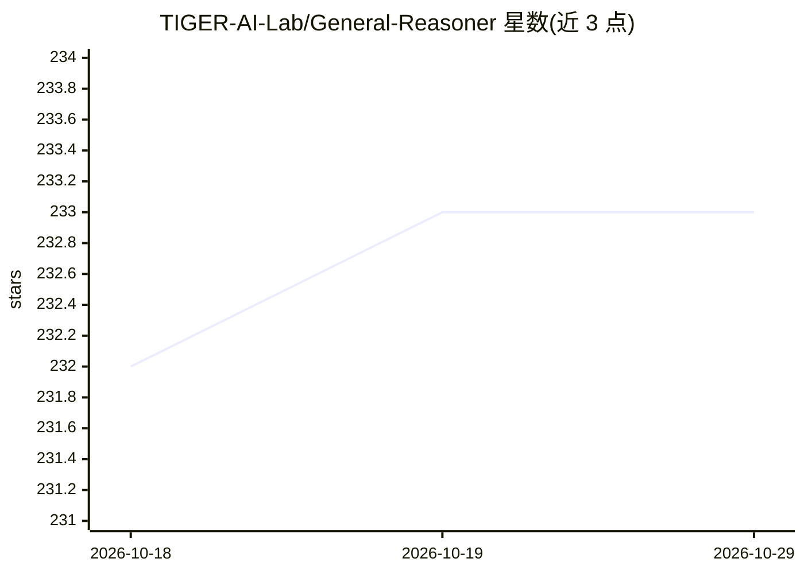

# TIGER-AI-Lab/General-Reasoner

⭐ 233 · Python · 推送 2025-11-27 · [GitHub](https://github.com/TIGER-AI-Lab/General-Reasoner) · [官网](https://tiger-ai-lab.github.io/General-Reasoner) · 组织维护

**面向多领域 LLM 推理的 RL 训练框架与模型检查点**

TIGER-AI-Lab 发布的 LLM 推理研究工作（NeurIPS25）：在 GRPO 框架内引入基于模型的验证器，支持数学表达式、字符串、列表、分数、矩阵等多种答案类型验证，在 23 万条 WebInstruct-verified 数据上训练，无需额外 SFT。仓库提供 7B/14B 等 Qwen 底座的模型检查点、General-Verifier（1.5B）验证器、基于 VERL+vLLM 的完整训练与评测代码，另有单卡 Tinker 训练路径。给做 LLM 推理强化学习的研究者使用。

## 筛选速览

| 维度 | 判定 | 备注 |
|---|---|---|
| AI 角色 | `ai-native` | 本体是模型或模型工具 |
| 许可风险 | `none` | — |
| 部署形态 | `library` | 以包/库形式分发 |
| 模型依赖 | local-ok | 支持本地模型 |
| 硬件要求 | — | 无带数字的原话,不猜 |
| 安装摩擦 | `medium` | 含编译或系统依赖之一 |
| 成熟度 | — | 结构信号不足 |

## 能力要点

- 模型验证器支持多样答案类型（表达式/字符串/列表/分数/矩阵）
- 发布 Qwen2.5/Qwen3 底座的 7B/14B 检查点与 230k 训练数据
- 提供 MMLU-Pro、SuperGPQA、GPQA 等评测脚本
- 支持 Tinker 单本地 GPU 训练路径

## 适用场景

- 用模型验证器做跨领域推理的 RL 训练
- 下载检查点跑 MMLU-Pro/GPQA 等基准评测
- 在自有 RL 训练框架中接入 General-Verifier

## 场景标签

`强化学习` `模型评测` · 领域:评测与运维

## 证据(README 行号)

> L3: 🪡 We introduce a novel framework within GRPO to utilize model-based verifier to support wider range of answer types.
> L39: |General-Reasoner-Qwen2.5-7B|Qwen2.5-7B-Base|🤗|
> L82: bash train_general_reasoner.sh

## 星数曲线

2026-10-18 232 → 2026-10-29 233（+1）

---
*卡片 v1 · prompt 1.4 · 生成 2026-10-22 · 置信度 high · 依据 README sha `07762888f98e` · [字段定义](../../DATASET.md)*
