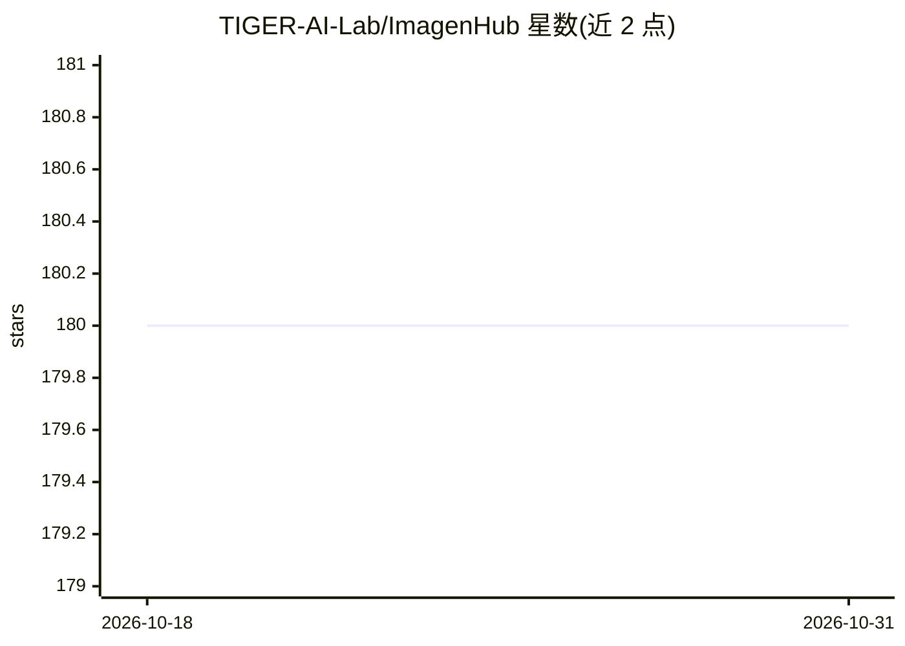

# TIGER-AI-Lab/ImagenHub

⭐ 180 · Python · MIT · 推送 2025-12-02 · [GitHub](https://github.com/TIGER-AI-Lab/ImagenHub) · [官网](https://tiger-ai-lab.github.io/ImagenHub/) · 组织维护

**条件图像生成模型的统一推理与评测基准库（ICLR 2024）**

面向图像生成/编辑研究者的基准库：定义 7 项任务并各配套一个评测数据集，构建统一推理管线以支持 50+ 生成模型（Stable Diffusion、SDXL、Dall-E、InstructPix2Pix、DreamBooth 等）的公平对比；设计语义一致性与感知质量两种人工评测指标及指南，并提供可视化工具、自动指标（如 LPIPS）与 Amazon Mechanical Turk 模板代码。通过 PyPI 安装，部分模型需 HuggingFace 登录及额外配置。项目仍在持续开发中。

## 筛选速览

| 维度 | 判定 | 备注 |
|---|---|---|
| AI 角色 | `ai-ecosystem` | LLM/agent 周边工具 |
| 许可风险 | `permissive` | MIT |
| 部署形态 | `library` | 以包/库形式分发 |
| 模型依赖 | — | README 未给出锁定关系 |
| 硬件要求 | — | 无带数字的原话,不猜 |
| 安装摩擦 | `low` | 无编译、无系统依赖或容器化 |
| 成熟度 | `idea` | |

## 能力要点

- 7 项任务与配套评测数据集
- 统一推理管线支持 50+ 条件图像生成模型
- 两项人工评测指标（Semantic Consistency / Perceptual Quality）与指南
- 提供可视化工具与自动指标（LPIPS 等）

## 适用场景

- 复现论文中的图像生成模型基准实验
- 统一管线下对比自己的生成模型与其他方法
- 为生成图像做人工评测与指标计算

## 场景标签

`模型评测` `图像生成` · 领域:评测与运维

## 证据(README 行号)

> L15: ImagenHub is a one-stop library to standardize the inference and evaluation of all the conditional image generation
> L18: * We designed two human evaluation scores, i.e. Semantic Consistency and Perceptual Quality, along with comprehensi

## 星数曲线

2026-10-18 180 → 2026-10-31 180（+0）

---
*卡片 v1 · prompt 1.4 · 生成 2026-10-22 · 置信度 high · 依据 README sha `fa5012327e8c` · [字段定义](../../DATASET.md)*
