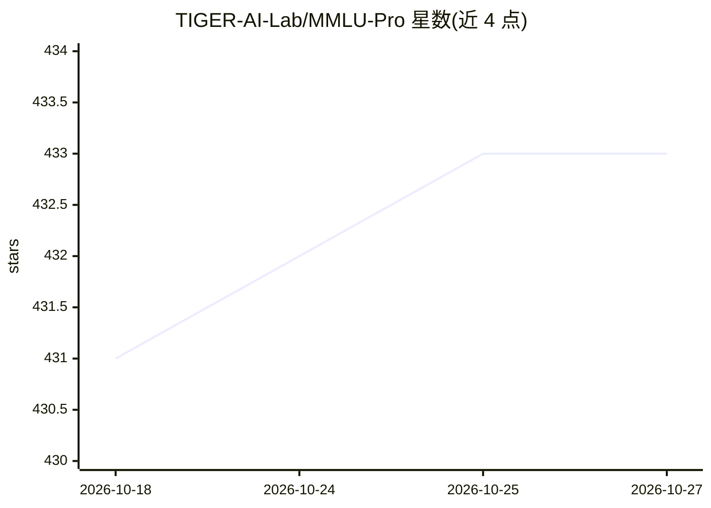

# TIGER-AI-Lab/MMLU-Pro

⭐ 433 · Python · Apache-2.0 · 推送 2026-03-18 · [GitHub](https://github.com/TIGER-AI-Lab/MMLU-Pro) · 组织维护

**更难更稳的 LLM 多任务理解评测基准（12k+ 题，14 领域）**

NeurIPS 2024 论文的代码与数据仓库：在 MMLU 基础上构建 MMLU-Pro，含 12,000+ 道来自学术考试与教科书的题目，答案选项从 4 个增至 10 个，覆盖 14 个领域；论文报告准确率较 MMLU 下降 16%-33%，且对 24 种提示风格更稳定。提供本地推理与 API 推理两套评测脚本（含多线程 OpenAI 兼容接口），附榜单与答案抽取稳健性讨论。面向做模型评测的研究者与开发者。

## 筛选速览

| 维度 | 判定 | 备注 |
|---|---|---|
| AI 角色 | `ai-ecosystem` | LLM/agent 周边工具 |
| 许可风险 | `permissive` | Apache-2.0 |
| 部署形态 | `None` |  |
| 模型依赖 | — | README 未给出锁定关系 |
| 硬件要求 | — | 无带数字的原话,不猜 |
| 安装摩擦 | `low` | 无编译、无系统依赖或容器化 |
| 成熟度 | — | 结构信号不足 |

## 能力要点

- 12,000+ 道题目，覆盖 14 个学科领域
- 每题 10 个选项，降低随机猜测命中率
- 提供本地推理与 API（含 OpenAI 兼容接口）两种评测脚本
- 仓库含 24 种测试过的提示风格

## 适用场景

- 评测 LLM 的知识与推理能力
- 比较不同模型在多学科任务上的准确率
- 研究提示风格对评测分数的影响

## 场景标签

`模型评测` · 领域:评测与运维

## 证据(README 行号)

> L5: This repo contains the evaluation code for the NeurIPS-24 paper "MMLU-Pro: A More Robust and Challenging Multi-Task 
> L8: We introduce MMLU-Pro, an enhanced benchmark designed to evaluate language understanding models across broader and m
> L22: To run local inference, modify the model name in the following script and execute it:

## 星数曲线

2026-10-18 431 → 2026-10-27 433（+2）

---
*卡片 v1 · prompt 1.4 · 生成 2026-10-22 · 置信度 high · 依据 README sha `0cfa08f1a6cc` · [字段定义](../../DATASET.md)*
