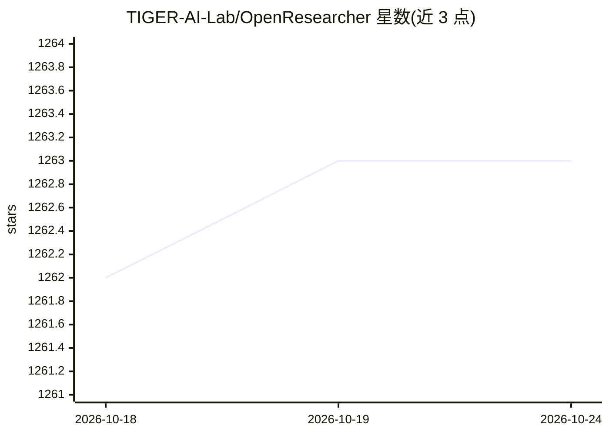

# TIGER-AI-Lab/OpenResearcher

⭐ 1,262 · Python · 推送 2026-06-10 · [GitHub](https://github.com/TIGER-AI-Lab/OpenResearcher) · [官网](https://github.com/TIGER-AI-Lab/OpenResearcher) · 组织维护 · 中文 README

**面向长程深度研究的开源 agentic LLM（30B-A3B）及全流程配方**

TIGER-AI-Lab 发布的深度研究智能体项目：开源 30B-A3B MoE 模型、96K 条 100+ 轮的深度研究轨迹数据集、蒸馏训练配方（基于 Megatron-LM 分支）与轻量评测框架。检索侧用自建 BM25/Dense 检索器服务或 Serper API，模型经 vLLM 部署运行；README 报告其在 BrowseComp-Plus 达 54.8% 准确率。官方环境为 8×A100 80G 与 Linux，需 JDK，另含可选的自训流程。

## 筛选速览

| 维度 | 判定 | 备注 |
|---|---|---|
| AI 角色 | `ai-native` | 本体是模型或模型工具 |
| 许可风险 | `none` | — |
| 部署形态 | `None` |  |
| 模型依赖 | local-ok | 支持本地模型 |
| 硬件要求 | — | 无带数字的原话,不猜 |
| 安装摩擦 | `medium` | 含编译或系统依赖之一 |
| 成熟度 | — | 结构信号不足 |

## 能力要点

- 开源 30B-A3B agentic 模型与 96K 深度研究轨迹数据集
- 自建 ~11B token 语料上的 BM25/Dense 检索器，免外部搜索 API（BrowseComp-Plus 场景）
- 覆盖 BrowseComp-Plus/BrowseComp/GAIA/xbench 的评测框架
- 提供 Megatron-LM 分支的蒸馏训练代码

## 适用场景

- 运行开源深度研究智能体完成多轮搜索与网页浏览任务
- 在 BrowseComp/GAIA 等基准上评测深度研究智能体
- 基于开源轨迹数据集训练自己的深度研究模型

## 场景标签

`科研工具` `模型评测` `模型训练` · 领域:评测与运维

## 证据(README 行号)

> L26: **OpenResearcher** is a fully open agentic large language model (30B-A3B) designed for **long-horizon deep research
> L35: + 🔑 **Fully Open-Source Recipe** — We fully open-source our 96K high-quality DeepResearch trajectory dataset with 1

## 星数曲线

2026-10-18 1,262 → 2026-10-24 1,263（+1）

---
*卡片 v1 · prompt 1.4 · 生成 2026-10-21 · 置信度 high · 依据 README sha `314173d21c4f` · [字段定义](../../DATASET.md)*
