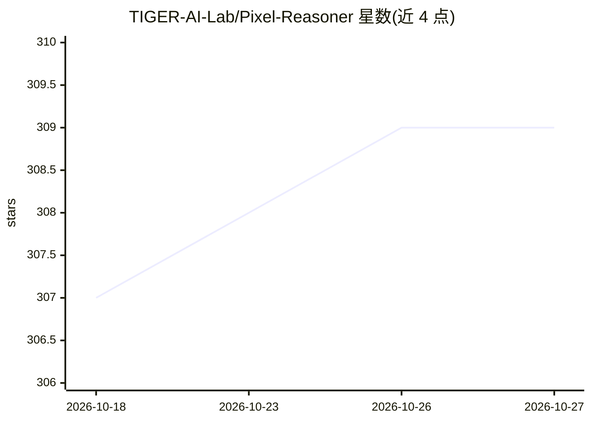

# TIGER-AI-Lab/Pixel-Reasoner

⭐ 309 · Python · MIT · 推送 2026-07-28 · [GitHub](https://github.com/TIGER-AI-Lab/Pixel-Reasoner) · [官网](https://tiger-ai-lab.github.io/Pixel-Reasoner/) · 组织维护 · 中文 README

**像素空间推理的视觉语言模型及 RL 训练框架**

提出让 VLM 在像素空间推理的方法：为模型配备 zoom-in、select-frame 等视觉操作，使其能直接检查与推断视觉证据。训练分两阶段：先在合成推理轨迹上做指令微调，再用好奇心驱动的强化学习平衡像素空间与文本推理的探索。仓库提供 7B 模型（HuggingFace 下载）、SFT/RL 训练脚本、基于 vLLM 的推理评测流程及图像/视频基准评测数据，训练基于 Qwen2.5-VL，适配改自 Open-R1 与 VL-Rethinker。面向多模态推理研究人员与开发者。

## 筛选速览

| 维度 | 判定 | 备注 |
|---|---|---|
| AI 角色 | `ai-native` | 本体是模型或模型工具 |
| 许可风险 | `permissive` | MIT |
| 部署形态 | `library` | 以包/库形式分发 |
| 模型依赖 | local-ok | 支持本地模型 |
| 硬件要求 | — | 无带数字的原话,不猜 |
| 安装摩擦 | `low` | 无编译、无系统依赖或容器化 |
| 成熟度 | `idea` | |

## 能力要点

- 两阶段后训练：指令微调 + 好奇心驱动 RL
- 支持多轮轨迹的 SFT 与 RL，混合图像/视频数据
- 提供 vLLM 推理评测流程与 V*MVBench 等基准数据
- 模型与训练/评测数据在 HuggingFace 发布

## 适用场景

- 复现或开展像素空间视觉推理的模型训练研究
- 在 V*、TallyQA、MVBench 等视觉基准上评测 VLM
- 下载 PixelReasoner-RL-v1 模型做视觉推理推理应用

## 场景标签

`多模态` `强化学习` `模型评测` · 领域:评测与运维

## 证据(README 行号)

> L44: Chain-of-thought reasoning has significantly improved the performance of Large Language Models (LLMs) across variou
> L45: Cultivating such pixel-space reasoning capabilities in VLMs presents notable challenges, including the model's init

## 星数曲线

2026-10-18 307 → 2026-10-27 309（+2）

---
*卡片 v1 · prompt 1.4 · 生成 2026-10-22 · 置信度 mid · 依据 README sha `1dcb51676a41` · [字段定义](../../DATASET.md)*
