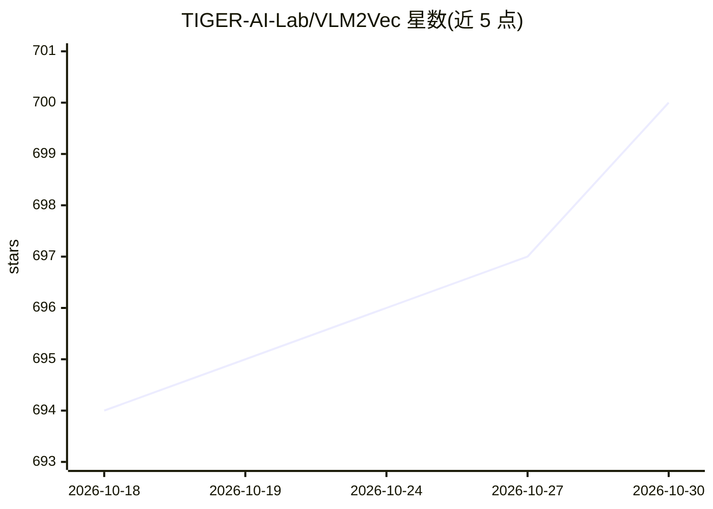

# TIGER-AI-Lab/VLM2Vec

⭐ 700 · Python · Apache-2.0 · 推送 2026-10-23 · [GitHub](https://github.com/TIGER-AI-Lab/VLM2Vec) · [官网](https://tiger-ai-lab.github.io/VLM2Vec/) · 组织维护

**全模态嵌入模型训练框架与 MMEB 系列评测基准**

提供 VLM2Vec 多模态嵌入模型的训练与评测代码，以及 MMEB 系列基准（V2 共 78 任务；V3 扩展至 190 任务，覆盖文本、图像、视频、音频、视觉文档与 agent 检索任务），并附带 OmniSET 诊断组件用于跨模态等价实例分析。V2 模型基于 Qwen2-VL 骨干做指令引导的对比训练，输出固定维度嵌入。数据托管于 Hugging Face，评估脚本通过 --data_basedir 运行，支持多 GPU DDP 推理；部分基线模型有 transformers 版本限制。

## 筛选速览

| 维度 | 判定 | 备注 |
|---|---|---|
| AI 角色 | `ai-knowledge` | 知识聚合/清单类 |
| 许可风险 | `permissive` | Apache-2.0 |
| 部署形态 | `None` |  |
| 模型依赖 | — | README 未给出锁定关系 |
| 硬件要求 | — | 无带数字的原话,不猜 |
| 安装摩擦 | `low` | 无编译、无系统依赖或容器化 |
| 成熟度 | — | 结构信号不足 |

## 能力要点

- MMEB-V3 基准含 190 个任务，覆盖 6 类模态/场景
- VLM2Vec-V2 基于 Qwen2-VL 的统一多模态嵌入训练框架
- OmniSET 跨模态语义等价诊断组件
- 提供 Hugging Face 数据集与 MMEB 排行榜

## 适用场景

- 训练图像/视频/文档统一嵌入模型
- 评测嵌入模型在多模态检索任务上的表现
- 分析嵌入模型对模态指令的遵循情况

## 场景标签

`模型评测` `模型训练` · 领域:评测与运维

## 证据(README 行号)

> L28: This repository contains the code and data interface for **MMEB-V3**, a comprehensive benchmark for evaluating **om
> L122: This repository contains the official code and data for **VLM2Vec-V2**, a unified framework for learning powerful 
> L141: - **[2026-04] MMEB-V3 is released!** We introduce a comprehensive omni-modality embedding benchmark covering **tex

## 星数曲线

2026-10-18 694 → 2026-10-30 700（+6）

---
*卡片 v1 · prompt 1.4 · 生成 2026-10-21 · 置信度 high · 依据 README sha `bf5f783709c7` · [字段定义](../../DATASET.md)*
